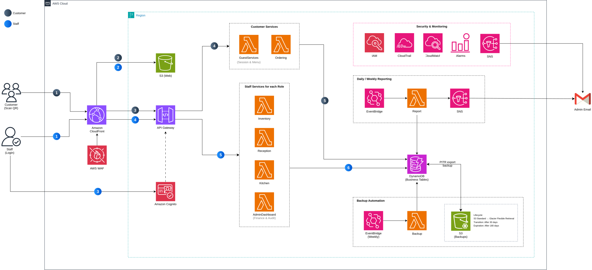

Trước khi triển khai các dịch vụ trên AWS Console, chúng ta cần hiểu cách các thành phần của **SecureTable** kết nối và trao đổi dữ liệu. Hệ thống được xây dựng theo kiến trúc **AWS Serverless**, tập trung vào ba yêu cầu: xử lý đúng nghiệp vụ nhà hàng, bảo vệ dữ liệu và tối ưu chi phí cho quy mô nhỏ.

Trong phần này, chúng ta sẽ phân tích sơ đồ kiến trúc đã sử dụng để triển khai SecureTable, các luồng xử lý chính và công nghệ được lựa chọn.

## 1. Sơ đồ kiến trúc SecureTable

### 1.1. Luồng hoạt động của khách hàng (Guest)

1. **Truy cập website:** Khách quét mã QR cố định trên bàn. Trình duyệt tải giao diện từ **Amazon CloudFront**, với các tệp HTML, CSS và JavaScript lưu trong **Amazon S3**.
2. **Tạo Guest Session:** Frontend gửi `POST /v1/guest/sessions` đến **Amazon API Gateway**. **GuestServices Lambda** kiểm tra bàn đang `OCCUPIED` và hóa đơn tương ứng đang `OPEN` trong **Amazon DynamoDB**. Nếu hợp lệ, hệ thống cấp Guest Session Token.
3. **Xem thực đơn:** Frontend gọi `GET /v1/guest/menu` kèm token. GuestServices kiểm tra phiên truy cập, đọc món ăn và tình trạng nguyên liệu từ DynamoDB, sau đó trả danh sách món có thể đặt.
4. **Đặt món:** Frontend gọi `POST /v1/guest/orders` đến **Ordering Lambda**. Lambda xác thực phiên, kiểm tra dữ liệu món và thực hiện **DynamoDB Transactions** để ghi nhận đơn hàng cùng lượng nguyên liệu đặt giữ.
5. **Theo dõi xử lý:** Các món được ghi nhận trong dữ liệu đơn hàng để bộ phận Kitchen tiếp nhận. Khách có thể tiếp tục đặt thêm khi hóa đơn còn mở.

Khách hàng **không đăng nhập bằng Amazon Cognito**. Quyền truy cập các API dành cho Guest được kiểm tra bằng Guest Session Token và trạng thái hóa đơn tại backend.

### 1.2. Luồng hoạt động của nhân viên (Staff)

1. **Đăng nhập:** Nhân viên truy cập giao diện Staff qua CloudFront và xác thực bằng **Amazon Cognito User Pool**.
2. **Phân quyền:** Sau khi đăng nhập, nhân viên được chuyển đến giao diện theo nhóm quyền. Các API dành cho Staff được bảo vệ bằng **Cognito Authorizer** tại API Gateway và kiểm tra quyền ở Lambda.
3. **Reception:** **Reception Lambda** quản lý bàn, mở hóa đơn, xem chi tiết và đóng hóa đơn. Khi đóng, bill được chuyển qua trạng thái `CLOSING` trước khi hoàn tất và giải phóng bàn.
4. **Kitchen:** **Kitchen Lambda** đọc danh sách món chờ, cho phép xác nhận hoàn tất hoặc từ chối món. Những thay đổi liên quan đến tồn kho và hóa đơn được xử lý theo quy tắc nghiệp vụ.
5. **Inventory:** **Inventory Lambda** ghi nhận nhập nguyên liệu, cập nhật tồn kho và lưu lịch sử điều chỉnh.
6. **Admin:** **AdminDashboard Lambda** cung cấp dữ liệu tài chính và nhật ký thao tác (**Audit Logs**) để hỗ trợ kiểm tra hoạt động nhà hàng.

Các Lambda truy cập những bảng DynamoDB cần thiết bằng **IAM Execution Role**. Các thao tác ghi quan trọng sử dụng điều kiện cập nhật, transaction hoặc **Idempotency-Key** nhằm hạn chế xung đột và xử lý trùng request.

### 1.3. Luồng tự động hóa báo cáo và sao lưu

- **Báo cáo:** **Amazon EventBridge Scheduler** kích hoạt **Report Lambda** theo lịch. Lambda tổng hợp dữ liệu từ DynamoDB và gửi nội dung báo cáo qua **Amazon SNS** đến email quản trị.
- **Sao lưu:** EventBridge Scheduler kích hoạt **Backup Lambda**. Lambda khởi tạo quá trình **DynamoDB Export to S3** đối với các bảng trong phạm vi backup. Dữ liệu được lưu trên S3; **S3 Lifecycle** có thể chuyển bản sao sang **S3 Glacier Flexible Retrieval** sau thời gian cấu hình.

Hai luồng này vận hành độc lập với các request gọi món thông thường. Việc xuất dữ liệu và chuyển lớp lưu trữ là các thao tác bất đồng bộ, không đồng nghĩa với khả năng khôi phục tức thì.

### 1.4. Giám sát, bảo mật và độ tin cậy

- **Amazon CloudWatch:** Thu thập Lambda logs, metrics và dữ liệu giám sát API Gateway; CloudWatch Alarms có thể gửi cảnh báo qua SNS.
- **AWS CloudTrail:** Hỗ trợ theo dõi hoạt động AWS API ở cấp tài khoản. CloudTrail khác với Audit Logs nghiệp vụ được lưu trong DynamoDB.
- **Amazon Cognito & AWS IAM:** Xác thực nhân viên và phân quyền truy cập tài nguyên theo nguyên tắc **least privilege**.
- **Amazon CloudFront & HTTPS:** Phân phối website bằng kết nối mã hóa. **AWS WAF** bổ sung khả năng lọc request nếu được bật và cấu hình trên distribution.
- **DynamoDB Transactions & Backup:** Giúp duy trì tính nhất quán dữ liệu cho các thao tác quan trọng và cung cấp dữ liệu phục vụ phục hồi khi gặp sự cố.

**Giới hạn bảo mật:** QR tĩnh có thể bị sao chép. Guest Session chỉ bị ràng buộc với bill đang mở, nên cơ chế hiện tại chưa xác minh được người quét QR có thực sự ở tại bàn hay không.

---

## 2. Tổng hợp Tech Stack

| Thành phần | Công nghệ / Dịch vụ |
|---|---|
| **Frontend** | HTML, CSS, JavaScript; Amazon S3, Amazon CloudFront |
| **Backend** | Python, AWS Lambda, Amazon API Gateway (REST API) |
| **Database** | Amazon DynamoDB |
| **Authentication & Authorization** | Amazon Cognito, AWS IAM, Guest Session Token |
| **Automation & Notifications** | Amazon EventBridge Scheduler, Amazon SNS |
| **Backup & Storage** | DynamoDB Export to S3, Amazon S3, S3 Glacier Flexible Retrieval |
| **Monitoring & Security** | Amazon CloudWatch, AWS CloudTrail; AWS WAF |
| **Deployment** | AWS Management Console |

---

## 3. Ngân sách tham chiếu cho môi trường Demo

Trong Proposal, chúng ta đã lập dự toán cho một nhà hàng **10 bàn**, khoảng **20–30 hóa đơn/ngày**, **40.000 REST API request/tháng**, **60.000 Lambda invocation/tháng** và khoảng **1 GB dữ liệu DynamoDB**, triển khai tại Region Singapore (`ap-southeast-1`).

### 3.1. Chi phí dự kiến theo cấu hình Demo

| STT | Dịch vụ / Nhóm chi phí | Dự toán (USD/tháng) |
|:---:|---|---:|
| 1 | Amazon CloudFront & S3 Frontend | $0.50 |
| 2 | Amazon API Gateway (REST) | $0.20 |
| 3 | AWS Lambda | $0.30 |
| 4 | Amazon DynamoDB | $1.00 |
| 5 | Amazon Cognito | $0.00 |
| 6 | Amazon CloudWatch | $1.00 |
| 7 | Amazon EventBridge Scheduler & SNS | $0.10 |
| 8 | AWS WAF (thuộc CloudFront Free Plan) | $0.00 |
| 9 | DynamoDB PITR, Export & S3 Backup | $2.50 |
| 10 | AWS CloudTrail Event History | $0.00 |
| | **Tổng chi phí dịch vụ** | **$5.60** |
| | **Dự phòng phát sinh** | **$2.00** |
| | **Tổng ngân sách dự kiến** | **$7.60/tháng** |

**Lưu ý:** Mức $0 của WAF chỉ phù hợp nếu distribution thực sự sử dụng **CloudFront Free Plan** và tính năng WAF nằm trong phạm vi gói. Phí Lambda, PITR, export và lưu trữ phụ thuộc vào cấu hình, dung lượng thực tế.

### 3.2. Các biện pháp tối ưu đã áp dụng

- Sử dụng **Serverless** thay vì duy trì máy chủ EC2 hoạt động liên tục.
- Tổ chức Lambda theo nhóm nghiệp vụ; ví dụ **Reception** gộp quản lý bàn và hóa đơn.
- Điều chỉnh **Memory** và **Timeout** của Lambda theo số liệu CloudWatch.
- Phân phối frontend tĩnh bằng CloudFront và S3, không cần web server riêng.
- Sử dụng S3 Lifecycle để quản lý lưu trữ backup dài hạn.