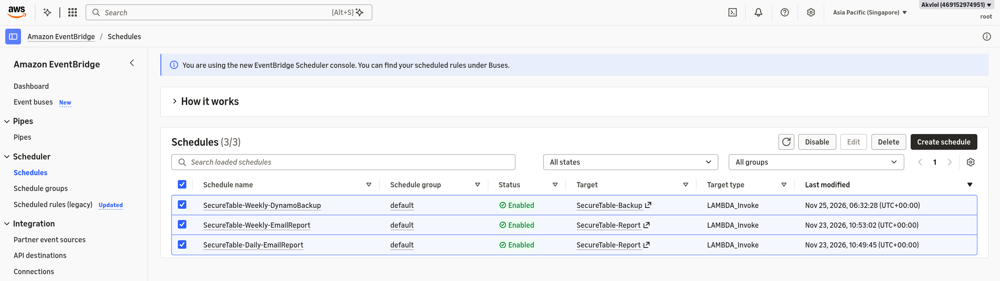
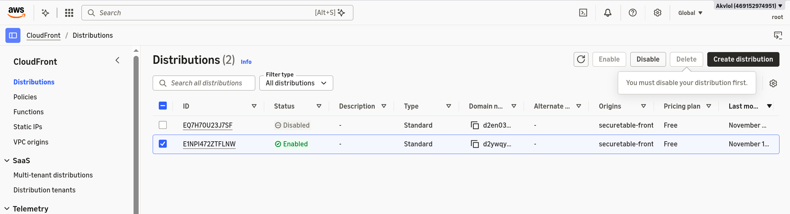
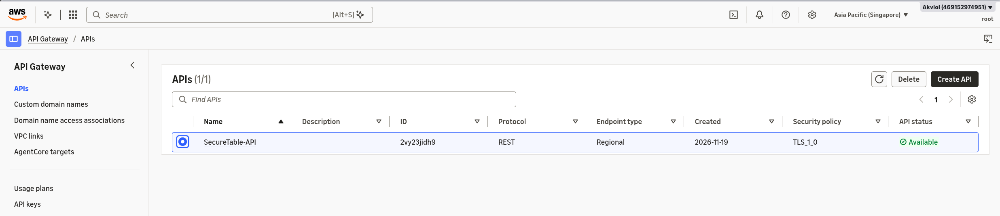
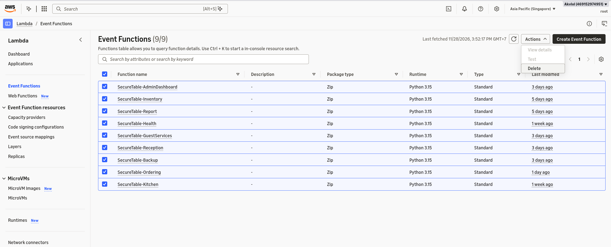
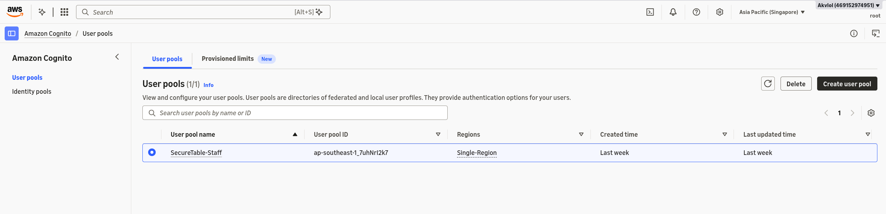
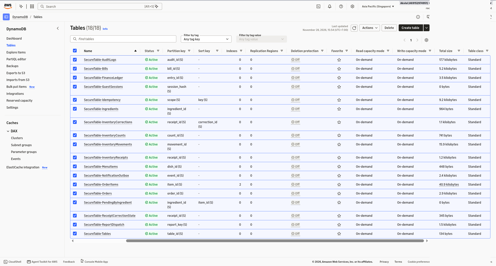
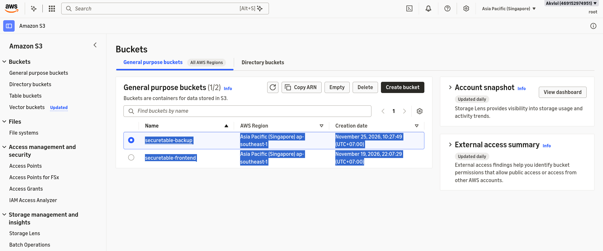
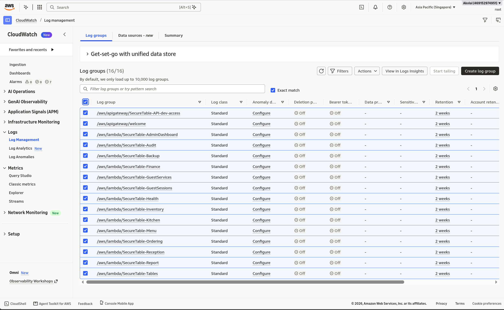
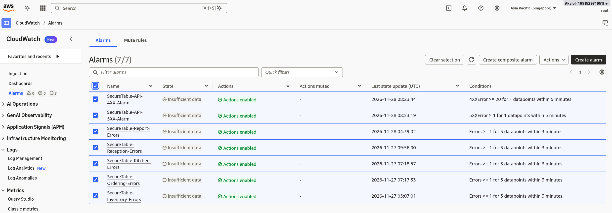
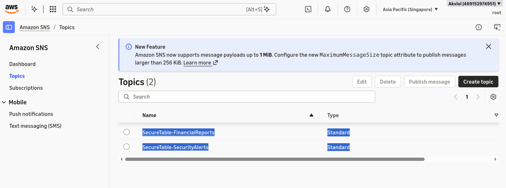

Sau khi hoàn thành và kiểm thử SecureTable, chúng ta sẽ xóa các tài nguyên AWS không còn sử dụng để tránh phát sinh chi phí. Toàn bộ thao tác được thực hiện trên **AWS Management Console**. Phần lớn tài nguyên nằm tại **Asia Pacific (Singapore) – `ap-southeast-1`**; **CloudFront** và **AWS WAF dành cho CloudFront** được quản lý ở phạm vi toàn cầu.

**Lưu ý:** Các thao tác dưới đây có thể làm mất dữ liệu vĩnh viễn.

## 1. Dừng các lịch chạy tự động

Để Report Lambda không tiếp tục gửi email và Backup Lambda không tạo thêm các tác vụ export, chúng ta sẽ dừng EventBridge Scheduler trước.

1. Truy cập **Amazon EventBridge → Scheduler → Schedules** tại Region `ap-southeast-1`.
2. Tìm các lịch sau:

   | Schedule | Chức năng |
   |---|---|
   | `SecureTable-Daily-EmailReport` | Gửi báo cáo tài chính hằng ngày |
   | `SecureTable-Weekly-EmailReport` | Gửi báo cáo tài chính hằng tuần |
   | `SecureTable-Weekly-DynamoBackup` | Sao lưu DynamoDB hằng tuần |

3. Chọn từng lịch, **Disable** nếu muốn tạm dừng để kiểm tra, sau đó chọn **Delete** khi đã sẵn sàng dọn dẹp.
4. Kiểm tra lại danh sách để xác nhận các lịch của SecureTable không còn tồn tại.



**Lưu ý:** Xóa Scheduler không tự xóa Lambda hoặc **IAM Execution Role** mà Scheduler từng sử dụng. Các role này sẽ được kiểm tra ở mục 7. Nếu một lần export DynamoDB đã được khởi tạo, xóa lịch cũng không tự hủy tác vụ export đó.

## 2. Xóa CloudFront Distribution và AWS WAF

1. Vào **Amazon CloudFront → Distributions**, chọn distribution phục vụ website SecureTable.
2. Nếu distribution đang sử dụng **CloudFront Free Plan hoặc một Pricing Plan khác**, hãy **Cancel pricing plan** trước. Với Free Plan, việc hủy thường có hiệu lực ngay; với gói trả phí, có thể cần đợi hết chu kỳ thanh toán.
3. Chọn **Disable** distribution và đợi thay đổi được triển khai.
4. Khi distribution đã bị vô hiệu hóa và không còn bị ràng buộc bởi pricing plan, chọn **Delete**.
5. Mở **AWS WAF → Web ACLs**, chọn phạm vi **CloudFront distributions (Global)** và kiểm tra Web ACL của SecureTable. Nếu Web ACL không còn được sử dụng, xóa nó nếu chưa được tự động xóa cùng distribution.



## 3. Xóa API Gateway, Lambda và Cognito

### 3.1. Xóa REST API

1. Truy cập **Amazon API Gateway → APIs** tại `ap-southeast-1`.
2. Chọn **`SecureTable-API`** → **Delete API** và xác nhận.
3. Kiểm tra API và stage `dev` không còn trong danh sách.



### 3.2. Xóa tám Lambda Functions

1. Truy cập **AWS Lambda → Functions**.
2. Lần lượt chọn và xóa các function thuộc SecureTable:

   | Lambda Function | Lambda Function |
   |---|---|
   | `SecureTable-GuestServices` | `SecureTable-Ordering` |
   | `SecureTable-Reception` | `SecureTable-Kitchen` |
   | `SecureTable-Inventory` | `SecureTable-AdminDashboard` |
   | `SecureTable-Report` | `SecureTable-Backup` |

3. Xác nhận các function không còn xuất hiện trong danh sách.



### 3.3. Xóa Cognito User Pool

1. Mở **Amazon Cognito → User pools**.
2. Chọn **`SecureTable-Staff`** và thực hiện **Delete user pool**.
3. Nếu bật **Deletion protection**, làm theo hướng dẫn của Console để tắt cơ chế bảo vệ trước khi xác nhận xóa.



## 4. Xóa các bảng Amazon DynamoDB

1. Mở **Amazon DynamoDB → Tables** tại `ap-southeast-1`.
2. Lọc tên `SecureTable-` và kiểm tra các bảng thuộc hệ thống.
3. Chọn từng bảng → **Delete** và xác nhận theo yêu cầu của Console.
4. Tiếp tục đến khi không còn bảng `SecureTable-*` thuộc dự án.

Các bảng được tạo trong Workshop gồm:

```text
SecureTable-Tables                  SecureTable-Bills
SecureTable-Orders                  SecureTable-OrderItems
SecureTable-MenuItems               SecureTable-Ingredients
SecureTable-InventoryReceipts       SecureTable-InventoryCorrections
SecureTable-ReceiptCorrectionState  SecureTable-InventoryMovements
SecureTable-InventoryCounts         SecureTable-FinanceLedger
SecureTable-AuditLogs               SecureTable-GuestSessions
SecureTable-Idempotency             SecureTable-PendingByIngredient
SecureTable-NotificationOutbox      SecureTable-ReportDispatch
```



**Lưu ý:** Xóa bảng cũng xóa dữ liệu đang sử dụng của bảng đó. Nếu còn cần dữ liệu cho demo hoặc đối chiếu, hãy giữ bản sao phù hợp trước khi xóa. Các bản export đã lưu trong S3 **không tự bị xóa** khi bảng DynamoDB bị xóa.

## 5. Xóa các S3 Buckets của SecureTable

Sau khi CloudFront đã bị xóa và không còn tác vụ export đang ghi vào S3:

1. Mở **Amazon S3 → General purpose buckets**.
2. Chọn **frontend bucket** đã tạo ở mục 5.3 → **Empty** để xóa các file website.
3. Khi bucket trống, chọn **Delete bucket** và xác nhận.
4. Thực hiện tương tự với **backup bucket** đã tạo ở mục 5.7 (ví dụ `securetable-backup`), nếu không cần giữ bản sao lưu.
5. Kiểm tra lại danh sách để xác nhận hai bucket của dự án đã được dọn dẹp.



**Lưu ý:** Nếu bucket có **S3 Versioning**, cần xóa cả các object versions và delete markers. Những object được chuyển sang **S3 Glacier Flexible Retrieval** có thời gian lưu trữ tính phí tối thiểu 90 ngày; xóa sớm có thể vẫn phát sinh phí lưu trữ cho thời gian còn lại. Chỉ xóa backup khi chắc chắn không cần khôi phục dữ liệu.

## 6. Dọn dẹp CloudWatch và SNS

1. Mở **Amazon CloudWatch → Alarms → All alarms**, xóa các alarm đã tạo cho SecureTable, ví dụ `SecureTable-Ordering-Errors` và `SecureTable-Kitchen-Errors`.
2. Vào **CloudWatch → Logs → Log groups**, xóa các nhóm log không cần giữ lại, bao gồm `/aws/lambda/SecureTable-*` và `/aws/apigateway/SecureTable-API-dev-access`.
3. Mở **Amazon SNS → Topics**, xóa các topic chỉ dùng cho hệ thống:
   - `SecureTable-FinancialReports`
   - `SecureTable-SystemAlerts`
4. Kiểm tra những subscription liên quan không còn cần sử dụng.





**Lưu ý:** CloudWatch Logs có thể tiếp tục lưu dữ liệu và tính phí sau khi Lambda bị xóa. **CloudTrail Event history** mặc định không cần xóa. Nếu đã tạo một CloudTrail Trail riêng cho SecureTable, chỉ xóa trail đó khi chắc chắn không được dùng chung; các file log lưu trên S3 và Log Groups liên quan vẫn cần dọn riêng.

## 7. Kiểm tra IAM và chi phí còn lại

1. Mở **IAM → Roles**, tìm các Execution Roles chỉ phục vụ 8 Lambda SecureTable, ba EventBridge Schedules và API Gateway Access Logging.
2. Xóa các **customer-created roles** không còn được sử dụng. Nếu role có Inline Policies hoặc các Managed Policies được gắn vào, làm theo hướng dẫn Console để gỡ quyền trước khi xóa role. **Không xóa AWS Managed Policies hoặc service-linked roles dùng chung**.
3. Kiểm tra lại danh sách tài nguyên trong các dịch vụ **CloudFront, S3, Lambda, API Gateway, DynamoDB, Cognito, EventBridge Scheduler, SNS và CloudWatch**.
4. Mở **Billing and Cost Management → Bills / Cost Explorer** để theo dõi chi phí sau khi dọn dẹp. Dữ liệu chi phí có thể cập nhật trễ và phí đã phát sinh trước đó vẫn được ghi nhận.

**Kết quả:** Các tài nguyên phục vụ SecureTable đã được dừng và xóa theo đúng thứ tự, bao gồm lịch tự động, website, API, Lambda, cơ sở dữ liệu, backup, giám sát và IAM Roles không còn sử dụng.
