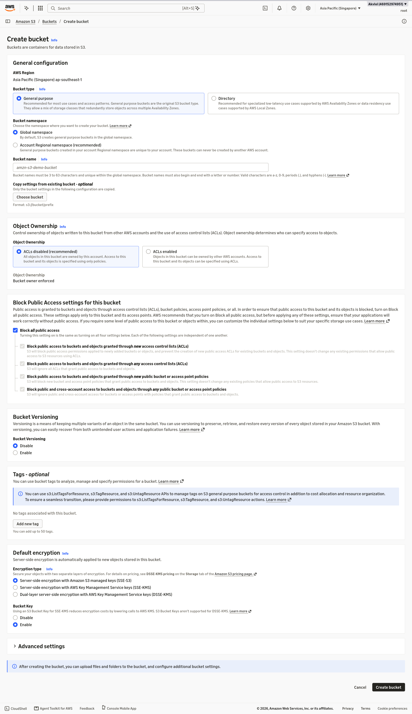
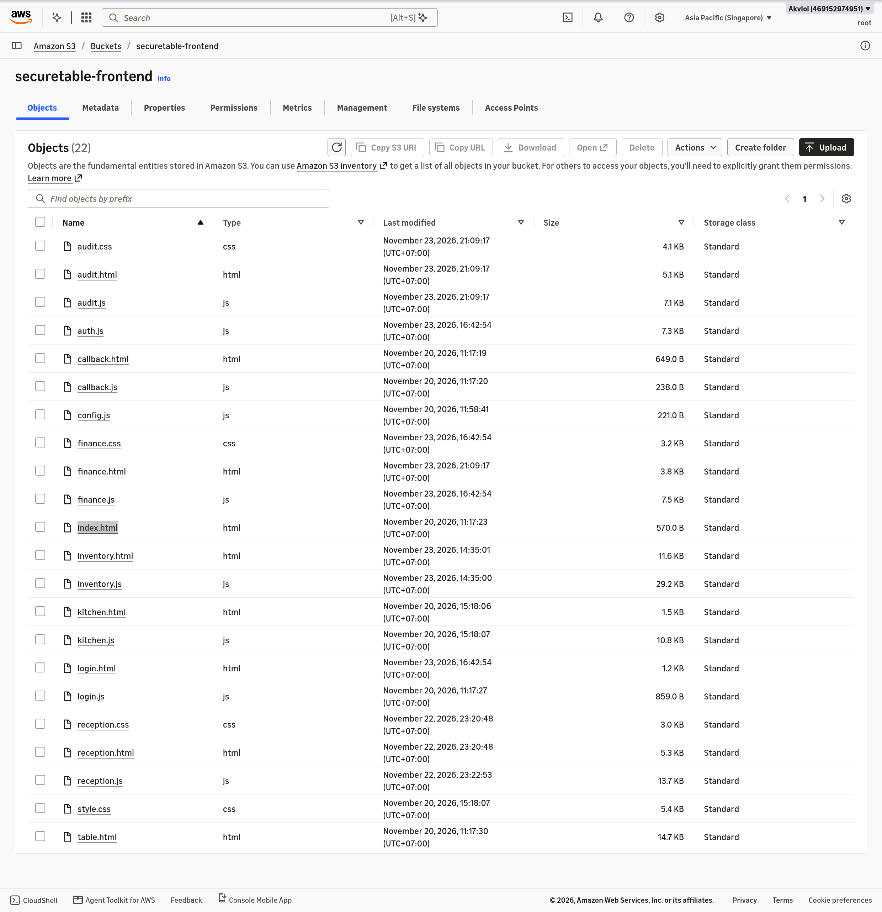
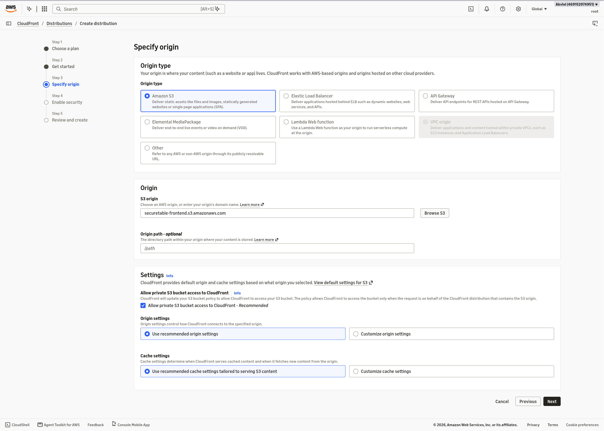
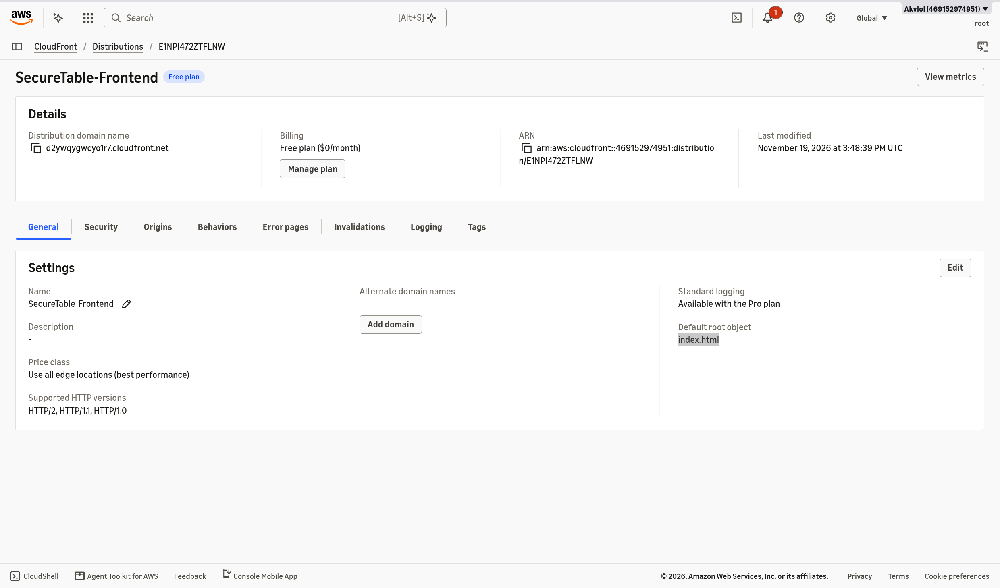

Trong phần này, chúng ta sẽ triển khai giao diện **SecureTable** lên **Amazon S3** và phân phối website qua **Amazon CloudFront**. Hệ thống sử dụng **một S3 bucket riêng tư** để lưu các trang Guest và Staff, đồng thời sử dụng CloudFront làm điểm truy cập qua HTTPS.

## 1. Tạo S3 Bucket

1. Truy cập **Amazon S3** trên AWS Console và chọn **Create bucket**.
2. Chọn **AWS Region: Asia Pacific (Singapore) – `ap-southeast-1`**.
3. Nhập tên bucket.
4. Giữ **Object Ownership: ACLs disabled** và bật **Block all public access**.
5. Giữ các cấu hình còn lại theo mặc định, sau đó chọn **Create bucket**.

**Lưu ý:** Không cần bật **S3 Static Website Hosting** hoặc cấp quyền public cho bucket. CloudFront sẽ đọc nội dung thông qua **Origin Access Control (OAC)**.

## 2. Upload Frontend

1. Mở bucket vừa tạo và chọn **Upload**.
2. Upload mã nguồn frontend của SecureTable [tại đây](https://github.com/Akvlol/SecureTable-source-code/tree/main/FrontEnd).
3. Chọn **Upload** để hoàn tất.

Đặt `index.html` tại **thư mục gốc của bucket** để CloudFront có thể tải trang mặc định.

**Lưu ý:** Các đường dẫn trong HTML phải khớp với vị trí thực tế của tệp trên S3. S3 chỉ lưu trữ nội dung tĩnh; xác thực nhân viên và xử lý đơn hàng sẽ được triển khai ở các phần sau.

## 3. Tạo CloudFront Distribution

1. Mở **Amazon CloudFront** và chọn **Create distribution**.
2. Chọn **CloudFront Free Plan** cho distribution và bật **AWS WAF** trong phạm vi tính năng của gói.
3. Chọn **Amazon S3** làm origin, sau đó chọn bucket frontend vừa tạo.
4. Sử dụng **Origin Access Control (OAC)** với chế độ **Sign requests (recommended)** để CloudFront có quyền đọc bucket riêng tư.
5. Giữ **Origin path** trống vì các tệp frontend được đặt tại thư mục gốc. 
6. Tạo distribution và kiểm tra **S3 bucket policy** đã cấp quyền đọc cho CloudFront. Nếu Console không tự cập nhật policy, áp dụng bucket policy do CloudFront cung cấp.
7. Sau khi tạo, cấu hình **Default root object:** `index.html`
8. Lưu thay đổi và kiểm tra trạng thái distribution chuyển sang **Deployed**.

CloudFront cấp một domain có dạng `dxxxxxxxxxxxxx.cloudfront.net`. Đây là địa chỉ dùng để truy cập SecureTable trong Workshop.

**Lưu ý:**
- **AWS Free Plan 6 tháng** và **CloudFront Free Plan** là hai chương trình khác nhau. Kiểm tra distribution đang sử dụng đúng CloudFront Free Plan để bảo đảm các tính năng nằm trong phạm vi miễn phí.
- **AWS WAF** đã được bật cho CloudFront; phần cấu hình và giám sát WAF sẽ được trình bày tại [5.8 – Security Hardening & System Monitoring](../5.8-Security/).
- Nếu không tạo được distribution do yêu cầu xác minh tài khoản, thực hiện theo [5.2 – Prerequisites](../5.2-Prerequisite).
