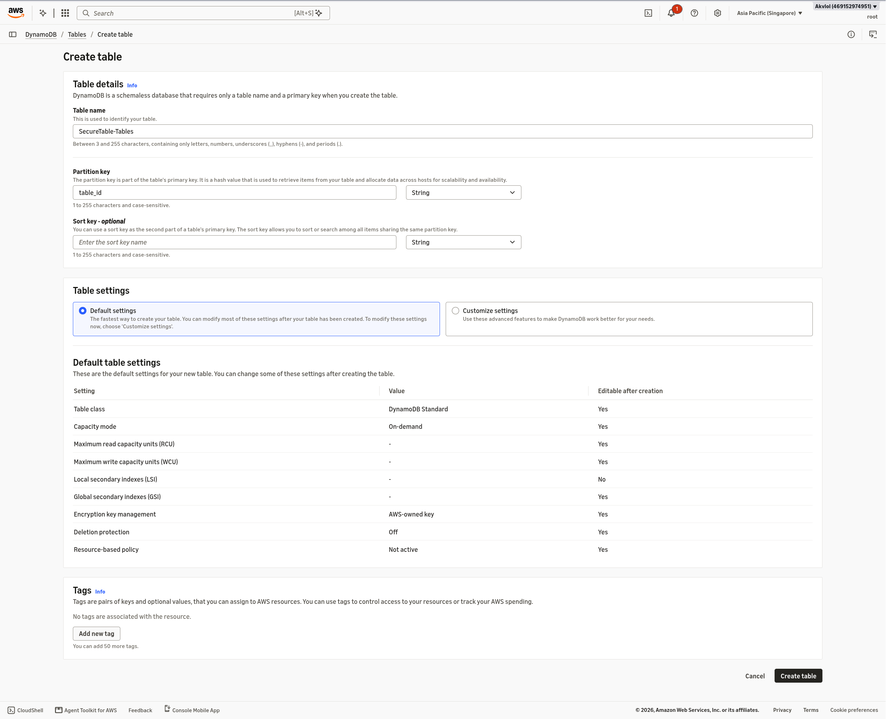
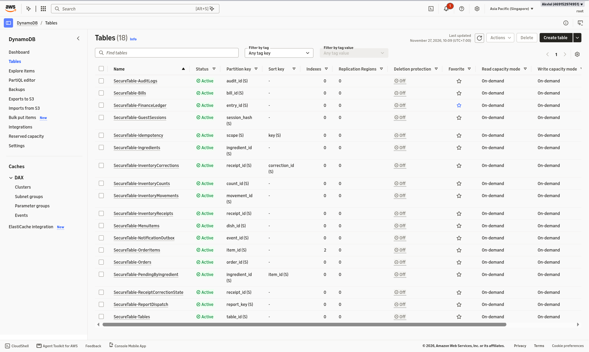
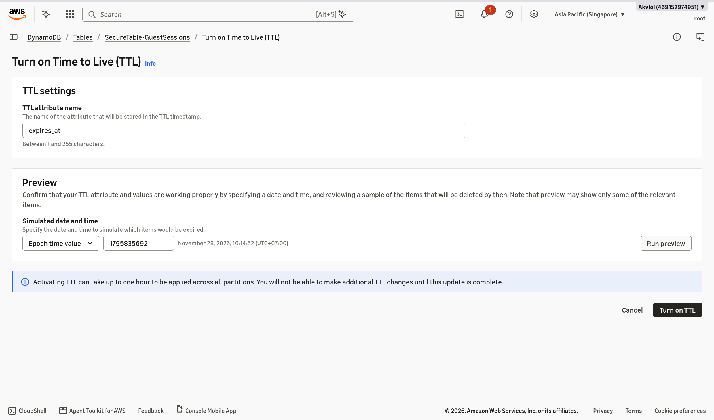
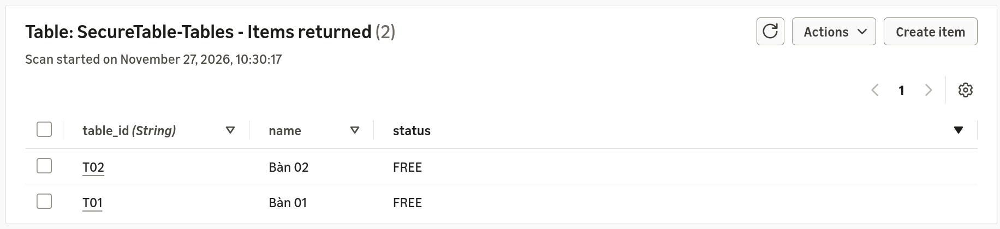
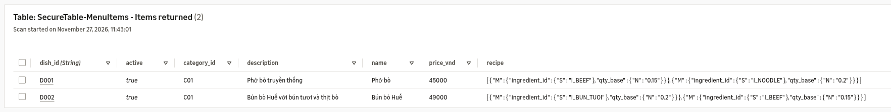
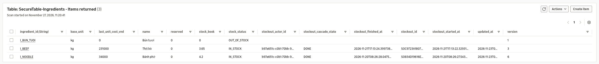

Trong phần này, chúng ta sẽ tạo các bảng **Amazon DynamoDB** để lưu trữ dữ liệu bàn, hóa đơn, đơn hàng, thực đơn, nguyên liệu và lịch sử hoạt động của **SecureTable**. Các bảng được triển khai tại **Asia Pacific (Singapore) – `ap-southeast-1`**, sử dụng chế độ **On-demand** để phù hợp với lưu lượng demo.

## 1. Tạo DynamoDB Table

Chúng ta sẽ tạo bảng `SecureTable-Tables`:

1. Truy cập **Amazon DynamoDB** trong AWS Console và chọn **Tables → Create table**.
2. Nhập **Table name:** `SecureTable-Tables`.
3. Nhập **Partition key:** `table_id` với kiểu dữ liệu **String**.
4. Để trống **Sort key**.
5. Giữ **Default settings** (**Capacity mode** mặc định là **On-demand**)
6. Chọn **Create table** và đợi trạng thái chuyển sang **Active**.



**Lưu ý:** `Partition key` và `Sort key` phải trùng **tên và kiểu dữ liệu** mà Lambda sử dụng. Không được tự ý đổi `table_id` thành `id`, vì backend sẽ không tìm được dữ liệu.

## 2. Tạo các bảng còn lại

Thực hiện tương tự bước trên cho các bảng của SecureTable. Dưới đây là những khóa chính được xác định từ cấu trúc dữ liệu và mã nguồn triển khai:


| DynamoDB Table | Partition key | Sort key |
|---|---|---|
| `SecureTable-Tables` | `table_id` | — |
| `SecureTable-Bills` | `bill_id` | — |
| `SecureTable-Orders` | `order_id` | — |
| `SecureTable-OrderItems` | `item_id` | — |
| `SecureTable-MenuItems` | `dish_id` | — |
| `SecureTable-Ingredients` | `ingredient_id` | — |
| `SecureTable-InventoryReceipts` | `receipt_id` | — |
| `SecureTable-InventoryCorrections` | `receipt_id` | `correction_id` |
| `SecureTable-ReceiptCorrectionState` | `receipt_id` | — |
| `SecureTable-InventoryMovements` | `movement_id` | — |
| `SecureTable-InventoryCounts` | `count_id` | — |
| `SecureTable-FinanceLedger` | `entry_id` | — |
| `SecureTable-AuditLogs` | `audit_id` | — |
| `SecureTable-GuestSessions` | `session_hash` | — |
| `SecureTable-Idempotency` | `scope` | `key` |
| `SecureTable-PendingByIngredient` | `ingredient_id` | `item_id` |
| `SecureTable-NotificationOutbox` | `event_id` | — |
| `SecureTable-ReportDispatch` | `report_key` | — |

Tất cả các khóa trên sử dụng kiểu **String**. Hệ thống còn sử dụng `SecureTable-ReportDispatch` để ghi nhận trạng thái gửi báo cáo và `SecureTable-NotificationOutbox` cho các sự kiện thông báo. Hai bảng phụ này phải được tạo theo khóa mà mã nguồn Lambda tương ứng sử dụng trước khi kích hoạt chức năng đó.




**Lưu ý:**

- SecureTable sử dụng tổng cộng **18 DynamoDB Tables**, được cấu hình ở chế độ **On-demand**.
- Trong đó, **13 bảng nghiệp vụ** thuộc phạm vi sao lưu định kỳ.
- Bảng `SecureTable-OrderItems` sử dụng **2 Global Secondary Indexes (GSI)** để hỗ trợ truy vấn.
- Khi tạo GSI, truy cập **DynamoDB → Tables → SecureTable-OrderItems → Indexes → Create index** và cấu hình theo các khóa truy vấn của hệ thống.
- Đợi trạng thái của GSI chuyển sang **Active** trước khi sử dụng.


## 3. Bật Time to Live (TTL)

SecureTable sử dụng TTL để tự động dọn dẹp dữ liệu tạm thời.

1. Mở bảng **`SecureTable-GuestSessions`**.
2. Trong phần **Additional settings**, tìm **Time to Live (TTL)** và chọn **Turn on**.
3. Nhập **TTL attribute name:** `expires_at`, sau đó lưu.



4. Thực hiện tương tự với bảng **`SecureTable-Idempotency`**, sử dụng thuộc tính `ttl`.

**Lưu ý:** Giá trị TTL phải là **Unix timestamp tính bằng giây** và DynamoDB xóa item hết hạn theo cơ chế bất đồng bộ, không phải ngay lập tức. Vì vậy Lambda vẫn phải kiểm tra thời hạn session khi xử lý request.

## 4. Thêm dữ liệu ban đầu

Để Reception có thể mở bill, cần tạo sẵn các bàn trong DynamoDB:

1. Mở bảng **`SecureTable-Tables` → Explore table items**.
2. Chọn **Create item**.
3. Thêm một item mẫu:

```json
{
  "table_id": {
    "S": "T01"
  },
  "name": {
    "S": "Bàn 01"
  },
  "status": {
    "S": "FREE"
  }
}
```

4. Chọn **Create item** rồi lặp lại với `T02`, `T03`, ... theo số bàn của nhà hàng.
5. Thêm dữ liệu thực đơn và nguyên liệu vào **`SecureTable-MenuItems`** và **`SecureTable-Ingredients`**





**Lưu ý:** Khi nhập item bằng **DynamoDB JSON**, dữ liệu có cú pháp khác JSON thông thường. Hãy chọn đúng chế độ nhập trong Console. Tên `dish_id` và `ingredient_id` trong menu/recipe phải khớp với dữ liệu nguyên liệu.

## 5. Kiểm tra kết quả

1. Truy cập **DynamoDB → Tables** và xác nhận các bảng đã tạo có trạng thái **Active**.
2. Mở **`SecureTable-Tables` → Explore table items** và kiểm tra dữ liệu `T01`, `T02`, ...
3. Kiểm tra **Capacity mode** của các bảng là **On-demand**.
4. Xác nhận **TTL** đã bật cho các bảng phiên và chống gửi request trùng.

**Lưu ý:** **Point-in-Time Recovery (PITR)** cần được bật cho 13 bảng thuộc phạm vi xuất dữ liệu sang S3. Chúng ta sẽ cấu hình và kiểm tra PITR tại [5.7 – Tự động hóa Báo cáo & Sao lưu dữ liệu](../5.7-Automation). PITR có chi phí riêng, kể cả khi chưa chạy tác vụ export.

Sau khi hoàn thành, cơ sở dữ liệu đã sẵn sàng để kết nối với Lambda trong [5.6 – Xây dựng Backend với AWS Lambda & API Gateway](../5.6-Backend-dev).
