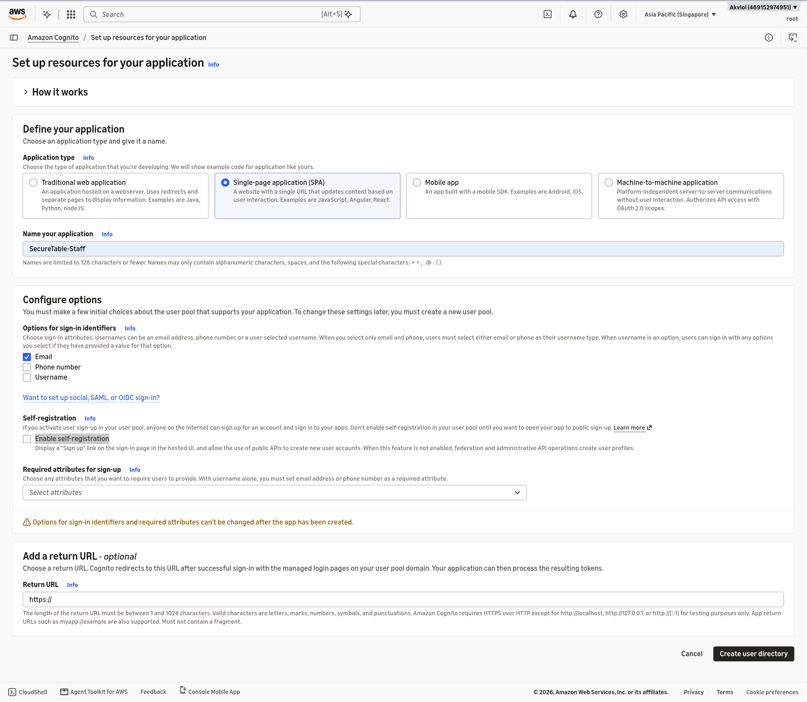
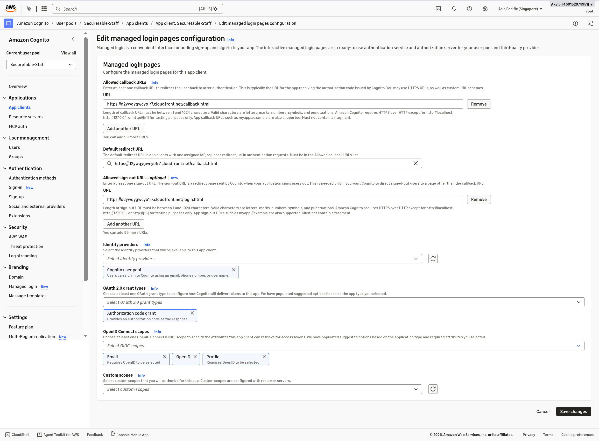
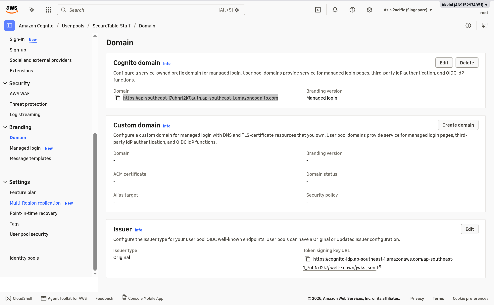
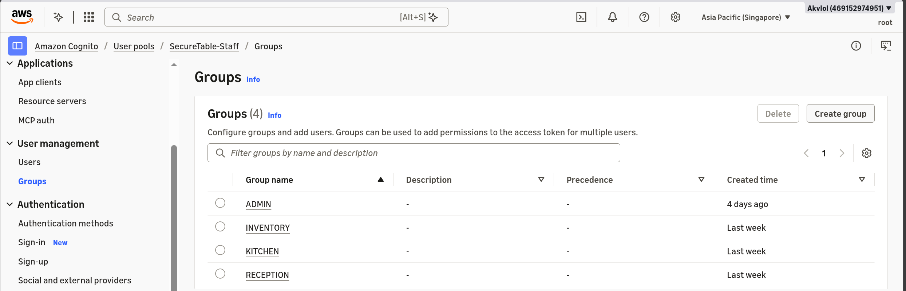
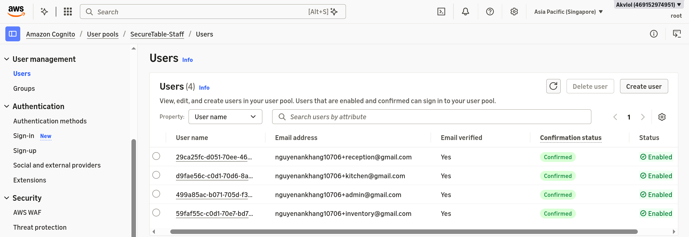
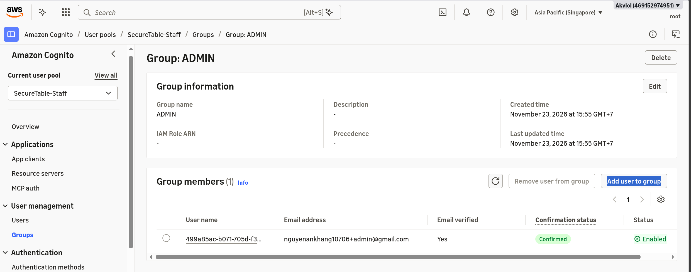
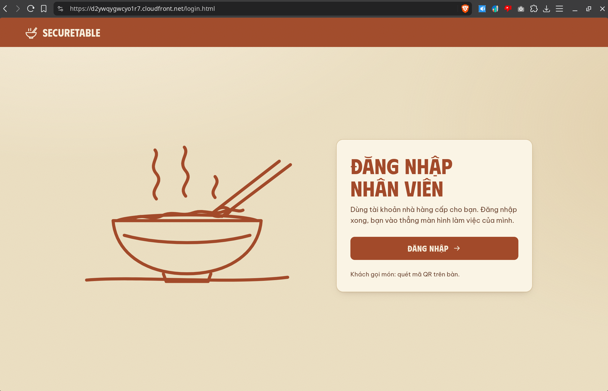
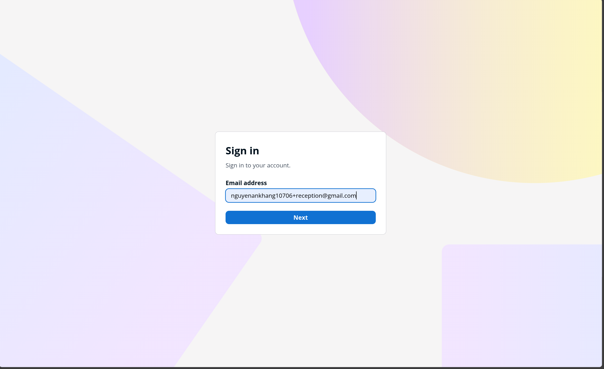

Trong phần này, chúng ta sẽ cấu hình **Amazon Cognito User Pool** để xác thực nhân viên và phân quyền theo từng bộ phận của **SecureTable**

**Lưu ý:** Khách hàng (Guest) **không sử dụng Cognito**. Guest được cấp Session Token qua API khi bàn có bill đang mở.

## 1. Tạo Cognito User Pool

1. Truy cập **Amazon Cognito** trên AWS Console và chọn Region **Asia Pacific (Singapore) – `ap-southeast-1`**.
2. Chọn **User pools → Create user pool**.
3. Chọn loại ứng dụng **Single-page application (SPA)** dành cho frontend HTML/JavaScript.
4. Đặt tên User Pool, ví dụ `SecureTable-Staff`; sử dụng phương thức đăng nhập bằng **Username** và mật khẩu.
5. Tắt **Self-registration** để chỉ người quản trị tạo tài khoản nhân viên, sau đó hoàn tất **Create user pool**.



**Lưu ý:** Không cần tạo User Pool cho Guest.

## 2. Cấu hình App Client & Trang đăng nhập

1. Trong User Pool, mở **App clients** và tạo hoặc chọn App Client dành cho website Staff.
2. Chọn **Single-page application (SPA)**, **không sử dụng Client Secret**.
3. Bật **Authorization code grant** với **PKCE**; chọn OAuth scopes tối thiểu `openid` (thêm `email` và `profile` nếu giao diện cần).
4. Thiết lập các URL sau, thay `<cloudfront-domain>` bằng domain ở mục 5.3:
   - **Callback URL:** `https://<cloudfront-domain>/callback.html`
   - **Sign-out URL:** `https://<cloudfront-domain>/login.html`
5. Trong mục **Domain**, tạo **Cognito domain** và cấu hình trang đăng nhập của User Pool (**Managed login** hoặc **Hosted UI**).
6. Lưu và ghi lại **User Pool ID**, **App Client ID**, **Cognito domain**.




**Lưu ý:** Callback URL phải khớp chính xác đường dẫn website, bao gồm `https://` và `/callback.html`. Không đưa Client Secret vào frontend JavaScript.

## 3. Tạo nhóm quyền & tài khoản nhân viên

1. Trong User Pool, chọn **Groups → Create group**.
2. Tạo các nhóm sau:

| Cognito Group | Chức năng |
|---|---|
| `RECEPTION` | Quản lý bàn, mở và đóng bill |
| `KITCHEN` | Tiếp nhận và xử lý món ăn |
| `INVENTORY` | Nhập kho và điều chỉnh nguyên liệu |
| `ADMIN` | Xem báo cáo tài chính và Audit Logs |



3. Chọn **Users → Create user** để tạo tài khoản cho nhân viên.



4. Thêm từng nhân viên vào nhóm tương ứng trong phần **Group membership**.




**Lưu ý:** Cognito đưa thông tin nhóm vào claim `cognito:groups` trong ID Token. Chuyển hướng giao diện theo role **không thay thế kiểm tra quyền tại backend**. Các Staff API sẽ được bảo vệ bằng **Cognito Authorizer** và kiểm tra quyền trong Lambda ở mục 5.6.

## 4. Kết nối Cognito với Frontend

1. Mở file `config.js` của frontend SecureTable.
2. Cập nhật các thông số Cognito:

```javascript
window.SECURETABLE_CONFIG = Object.freeze({
  cognitoDomain: 'https://<your-cognito-domain>',
  clientId: '<your-app-client-id>',
  userPoolId: '<your-user-pool-id>'
});
```

3. Upload đè `config.js` lên **S3 bucket frontend**.
4. Tạo **CloudFront Invalidation** cho `/config.js` nếu website vẫn hiển thị cấu hình cũ.
5. Truy cập `https://<cloudfront-domain>/login.html`, đăng nhập với tài khoản Staff và kiểm tra hệ thống chuyển về `callback.html`, sau đó vào đúng giao diện theo nhóm quyền.




**Lưu ý:** Ở bước này, chúng ta kiểm tra **đăng nhập và điều hướng giao diện**. Các API nghiệp vụ chỉ hoạt động đầy đủ sau khi triển khai backend trong mục 5.6.

Sau khi hoàn thành, **Cognito đã được cấu hình cho Staff**, các nhóm quyền và tài khoản nhân viên đã sẵn sàng.
