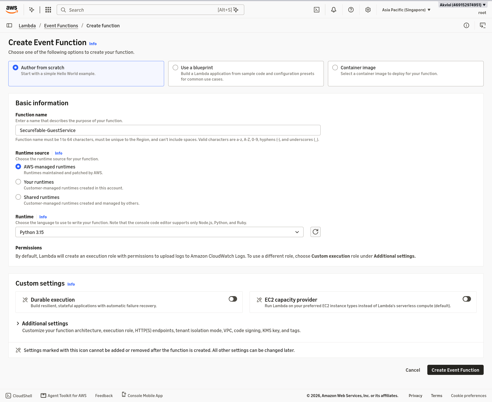
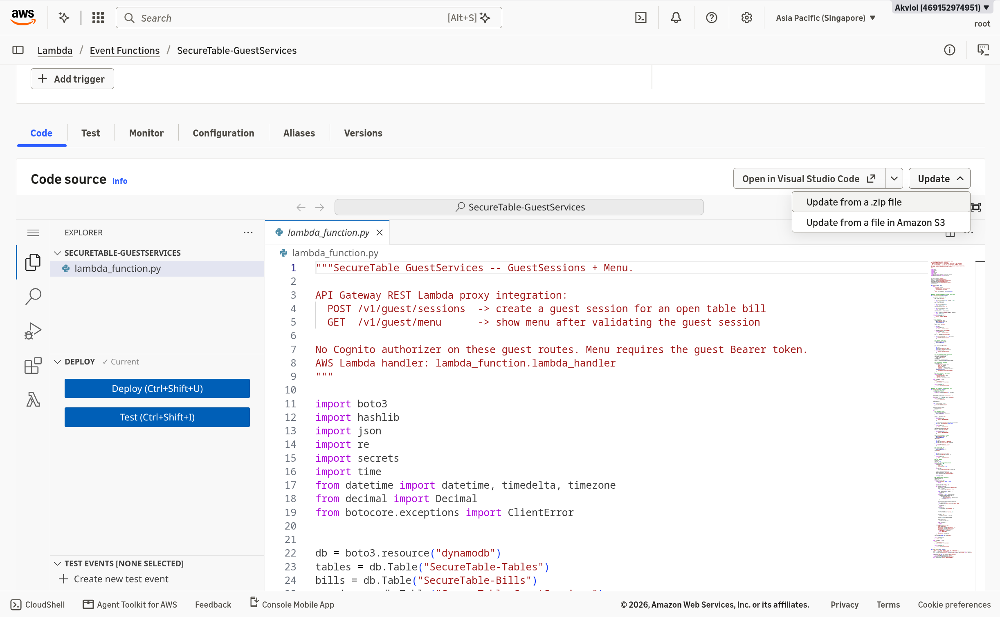
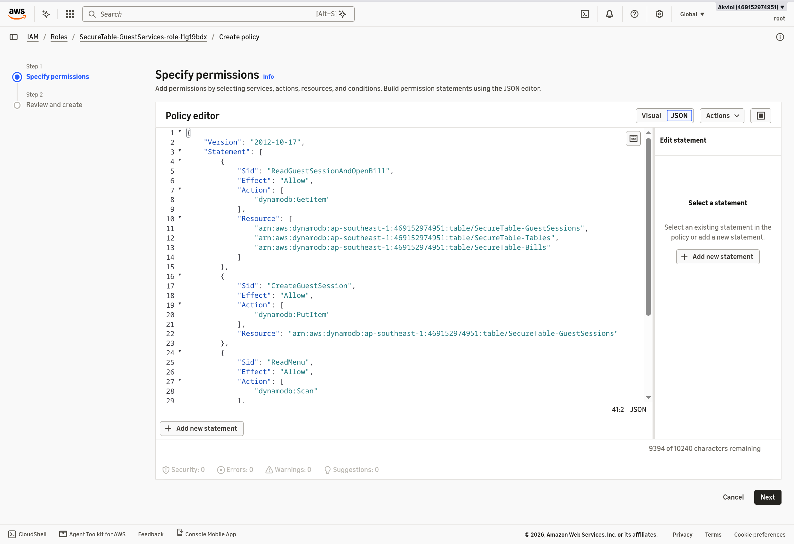
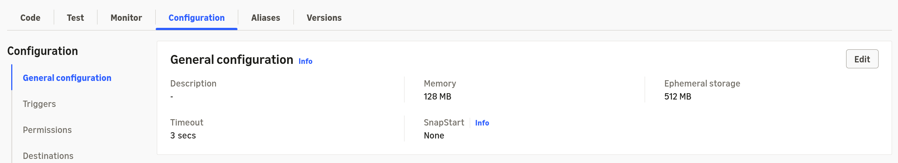
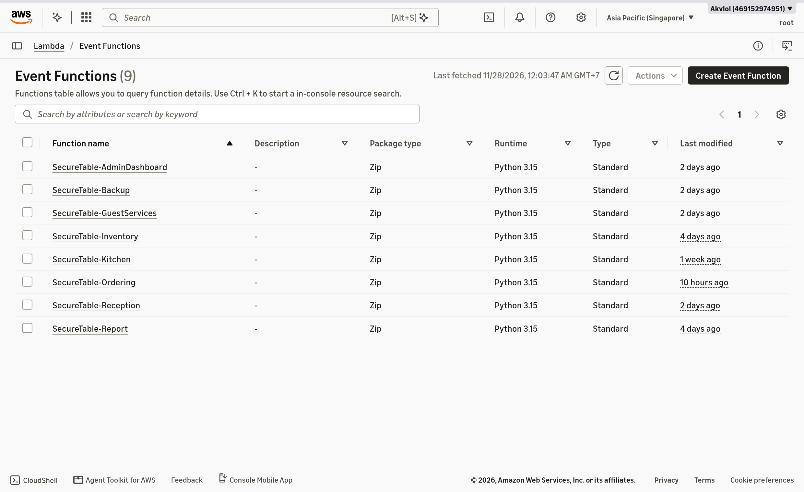

Trong phần này, chúng ta sẽ triển khai **8 AWS Lambda Functions** của SecureTable từ các gói mã nguồn được chuẩn bị trên GitHub. Mỗi function có một file ZIP chứa mã nguồn và một file JSON chứa **IAM Policy** tương ứng. Chúng ta sẽ tạo Lambda với **Execution Role mặc định**, sau đó bổ sung quyền để function có thể truy cập DynamoDB và các dịch vụ AWS cần thiết.

Tất cả Lambda được tạo tại **Asia Pacific (Singapore) – `ap-southeast-1`**, sử dụng **Python 3.15** (`python3.15`) cho **Lambda Event Functions**.

## 1. Chuẩn bị Source Code trên GitHub

Mã nguồn đã được đóng gói sẵn trong repository của SecureTable. Chọn liên kết dưới đây để tải source code trước khi triển khai:

**[Lấy source code ở đây](https://github.com/Akvlol/SecureTable-source-code/tree/main/Lambda)**

Thư mục `Lambda` có cấu trúc như sau:

```text
Lambda/
├── GuestServices/
│   ├── SecureTable-GuestServices.zip
│   └── SecureTable-GuestServices.json
├── Ordering/
│   ├── SecureTable-Ordering.zip
│   └── SecureTable-Ordering.json
├── Reception/
│   ├── SecureTable-Reception.zip
│   └── SecureTable-Reception.json
├── Kitchen/
│   ├── SecureTable-Kitchen.zip
│   └── SecureTable-Kitchen.json
├── Inventory/
│   ├── SecureTable-Inventory.zip
│   └── SecureTable-Inventory.json
├── AdminDashboard/
│   ├── SecureTable-AdminDashboard.zip
│   └── SecureTable-AdminDashboard.json
├── Report/
│   ├── SecureTable-Report.zip
│   └── SecureTable-Report.json
└── Backup/
    ├── SecureTable-Backup.zip
    └── SecureTable-Backup.json
```

Trong mỗi thư mục:

- File **`.zip`** là gói mã nguồn dùng để upload lên AWS Lambda.
- File **`.json`** là IAM Policy dùng để cấp quyền cho Execution Role của Lambda đó.

Có thể tải toàn bộ repository bằng **Code → Download ZIP** trên GitHub, sau đó giải nén repository để tìm các file bên trong thư mục `Lambda`. **Không upload file ZIP của toàn bộ repository lên Lambda**; chỉ sử dụng file `SecureTable-<FunctionName>.zip` tương ứng.

**Lưu ý:** Các file IAM Policy trong GitHub là **mẫu cấu hình**. Trước khi sử dụng, cần thay `<YOUR_ACCOUNT_ID>` bằng AWS Account ID của tài khoản đang triển khai. Các placeholder khác như `<YOUR_BACKUP_BUCKET>` cũng phải được thay bằng giá trị thực tế nếu xuất hiện trong policy.

## 2. Tạo AWS Lambda Function

Chúng ta sẽ sử dụng `SecureTable-GuestServices` làm ví dụ. Các Lambda còn lại được tạo tương tự.

1. Truy cập **AWS Lambda → Functions → Create function** trong AWS Console.
2. Chọn **Event Function** nếu giao diện yêu cầu chọn loại function, sau đó chọn **Author from scratch**.
3. Nhập các thông số:

   | Cấu hình | Giá trị |
   |---|---|
   | **Function name** | `SecureTable-GuestServices` |
   | **Runtime** | `Python 3.15` |
   | **Architecture** | `x86_64` |
   | **Execution role** | `Create a new role with basic Lambda permissions` |

4. Chọn **Create function**.
5. Đợi AWS tạo function và mở trang chi tiết của Lambda.



**Lưu ý:** Khi chọn **Create a new role with basic Lambda permissions**, AWS tự tạo **IAM Execution Role** và gắn quyền ghi logs lên **Amazon CloudWatch** (thông qua `AWSLambdaBasicExecutionRole`). Vì vậy, **không cần tạo IAM Role thủ công trước khi tạo Lambda**. Role này chưa có quyền truy cập DynamoDB, S3 hoặc SNS; chúng ta sẽ bổ sung quyền ở bước 4.

## 3. Upload Source Code cho Lambda

1. Trong repository, mở thư mục `Lambda/GuestServices`.
2. Tải file **`SecureTable-GuestServices.zip`** về máy.
3. Trở lại AWS Lambda `SecureTable-GuestServices`, mở tab **Code**.
4. Chọn **Upload from → .zip file**, chọn file vừa tải và xác nhận **Save**.
5. Tại **Runtime settings**, kiểm tra **Handler** là:

   ```text
   lambda_function.lambda_handler
   ```

6. Nếu Handler chưa đúng, chọn **Edit**, nhập giá trị trên và lưu lại.



Một gói ZIP thông thường có file xử lý chính `lambda_function.py` ở cấp gốc. Một số function có thể chứa thêm các module Python khác, ví dụ AdminDashboard sử dụng các module phục vụ Finance và Audit Logs.

**Lưu ý:** Hãy upload **nguyên file ZIP của từng Lambda**, không giải nén rồi upload từng file lên Console. Kiểm tra file `lambda_function.py` và các module được import nằm đúng vị trí trong gói ZIP. Các gói có thư viện ngoài hoặc mã được xây dựng trên runtime cũ cần được kiểm thử tương thích với Python 3.15.

## 4. Cấp quyền IAM cho Execution Role mặc định

Sau khi tạo Lambda, AWS đã cung cấp quyền ghi CloudWatch Logs nhưng chưa cấp quyền truy cập dữ liệu nghiệp vụ. Chúng ta sẽ sử dụng **file JSON tương ứng trên GitHub** để tạo một Inline Policy cho từng function.

### 4.1. Chuẩn bị IAM Policy

Với `SecureTable-GuestServices`:

1. Mở file **`Lambda/GuestServices/SecureTable-GuestServices.json`** trên GitHub.
2. Sao chép toàn bộ nội dung JSON.
3. Tìm và thay **tất cả** giá trị `<YOUR_ACCOUNT_ID>` bằng **AWS Account ID gồm 12 chữ số** của tài khoản đang sử dụng.
4. Kiểm tra tên bảng DynamoDB và Region trong policy trùng với tài nguyên đã tạo tại mục [5.4](../../5.4-Database-setup).

Ví dụ, một ARN mẫu:

```text
arn:aws:dynamodb:ap-southeast-1:<YOUR_ACCOUNT_ID>:table/SecureTable-Bills
```

Sau khi thay placeholder, ARN phải có đúng Account ID thực tế. **IAM không tự động thay thế `<YOUR_ACCOUNT_ID>`** khi lưu policy.

Đối với **`SecureTable-Backup.json`**, cần thay thêm `<YOUR_BACKUP_BUCKET>` bằng tên S3 bucket lưu backup. Đối với **`SecureTable-Report.json`**, kiểm tra ARN của SNS Topic `SecureTable-FinancialReports`; cách tạo và cấu hình các tài nguyên này sẽ được hướng dẫn trong mục [5.7](../../5.7-Automation).

### 4.2. Gắn Inline Policy vào Execution Role

1. Mở **AWS Lambda → Functions → SecureTable-GuestServices**.
2. Chọn **Configuration → Permissions**.
3. Trong phần **Execution role**, chọn liên kết tên role để mở **IAM Console**.
4. Chọn **Add permissions → Create inline policy**.
5. Chuyển sang tab **JSON** và dán nội dung file `SecureTable-GuestServices.json` đã thay Account ID.
6. Chọn **Next**, đặt tên policy, ví dụ `SecureTable-GuestServices-Policy`.
7. Chọn **Create policy** và kiểm tra policy mới xuất hiện trong phần quyền của role.



**Lưu ý:** Chỉ gắn file JSON của function tương ứng vào Execution Role của function đó. **Không** gắn `AmazonDynamoDBFullAccess` cho tất cả Lambda. Policy `AWSLambdaDynamoDBExecutionRole` chủ yếu phục vụ việc đọc **DynamoDB Streams**, không thay thế các quyền đọc/ghi bảng trong file JSON của SecureTable.

## 5. Cấu hình Memory, Timeout và Environment Variables

1. Trở lại trang Lambda, chọn **Configuration → General configuration → Edit**.
2. Điều chỉnh **Memory** và **Timeout** theo nhu cầu của function, sau đó chọn **Save**.
3. Nếu mã nguồn yêu cầu biến môi trường, mở **Configuration → Environment variables → Edit** và nhập các giá trị tương ứng.
4. Xác nhận **Runtime** là `Python 3.15` và **Handler** là `lambda_function.lambda_handler`.



Bảng sau là **cấu hình khởi đầu tham khảo** cho môi trường demo; cần kiểm tra lại khi triển khai thực tế:

| Lambda Function | Memory tham khảo | Timeout tham khảo |
|---|---:|---:|
| `SecureTable-GuestServices` | 256 MB | 15 giây |
| `SecureTable-Ordering` | 256 MB | 15 giây |
| `SecureTable-Reception` | 512 MB | 30 giây |
| `SecureTable-Kitchen` | 256 MB | 15 giây |
| `SecureTable-Inventory` | 512 MB | 30 giây |
| `SecureTable-AdminDashboard` | 512 MB | 30 giây |
| `SecureTable-Report` | Theo tác vụ | Cấu hình ở [5.7](../../5.7-Automation) |
| `SecureTable-Backup` | Theo tác vụ | Cấu hình ở [5.7](../../5.7-Automation) |

**Lưu ý:** Memory và Timeout không được xác định bởi file IAM Policy. Nếu Lambda báo lỗi `Task timed out` hoặc thiếu bộ nhớ, kiểm tra CloudWatch Logs và điều chỉnh cấu hình phù hợp. Với API đồng bộ, cần lưu ý giới hạn timeout phía API Gateway.

## 6. Triển khai các Lambda còn lại

Lặp lại quy trình **Tạo function → Upload ZIP → Cấu hình → Tạo IAM Inline Policy** cho đủ 8 Lambda sau:

| Lambda Function | File Source Code | File IAM Policy | Chức năng |
|---|---|---|---|
| `SecureTable-GuestServices` | `SecureTable-GuestServices.zip` | `SecureTable-GuestServices.json` | Cấp Guest Session và lấy thực đơn |
| `SecureTable-Ordering` | `SecureTable-Ordering.zip` | `SecureTable-Ordering.json` | Đặt món, giữ nguyên liệu và xem món đã đặt |
| `SecureTable-Reception` | `SecureTable-Reception.zip` | `SecureTable-Reception.json` | Quản lý bàn, mở và đóng bill |
| `SecureTable-Kitchen` | `SecureTable-Kitchen.zip` | `SecureTable-Kitchen.json` | Xử lý hàng đợi, hoàn tất hoặc từ chối món |
| `SecureTable-Inventory` | `SecureTable-Inventory.zip` | `SecureTable-Inventory.json` | Nhập kho, kiểm kê và điều chỉnh phiếu nhập |
| `SecureTable-AdminDashboard` | `SecureTable-AdminDashboard.zip` | `SecureTable-AdminDashboard.json` | Xem Finance Dashboard và Audit Logs |
| `SecureTable-Report` | `SecureTable-Report.zip` | `SecureTable-Report.json` | Tổng hợp và gửi báo cáo qua SNS |
| `SecureTable-Backup` | `SecureTable-Backup.zip` | `SecureTable-Backup.json` | Khởi tạo DynamoDB Export to S3 |

Hai function **`SecureTable-Report`** và **`SecureTable-Backup`** không cần tích hợp API Gateway. Chúng được kích hoạt bằng **Amazon EventBridge Scheduler**; chúng ta sẽ cấu hình lịch chạy, SNS và backup trong mục [5.7 – Tự động hóa Báo cáo & Sao lưu dữ liệu](../../5.7-Automation).

## 7. Kiểm tra kết quả

1. Vào **AWS Lambda → Functions**, xác nhận đã tạo đủ **8 Lambda Functions** và tên của chúng khớp với bảng trên.



2. Mở từng function, xác nhận mã nguồn ZIP được upload đúng, **Runtime là Python 3.15** và **Handler là `lambda_function.lambda_handler`**.
3. Vào **Configuration → Permissions**, xác nhận function có Execution Role và Inline Policy tương ứng, đồng thời vẫn có quyền ghi CloudWatch Logs.
4. Kiểm tra các placeholder trong JSON đã được thay đầy đủ, đặc biệt là Account ID, tên S3 bucket và SNS Topic.
5. Có thể sử dụng **Test** với event phù hợp để kiểm tra lỗi cú pháp, import hoặc cấu hình, sau đó xem **Monitor → View CloudWatch logs** khi function được gọi.

Sau khi hoàn thành, **8 Lambda của SecureTable** đã được triển khai từ các file ZIP trên GitHub, sử dụng **Python 3.15** và **Execution Role mặc định với IAM Policy riêng theo chức năng**, sẵn sàng kết nối với API Gateway hoặc các tác vụ tự động.
