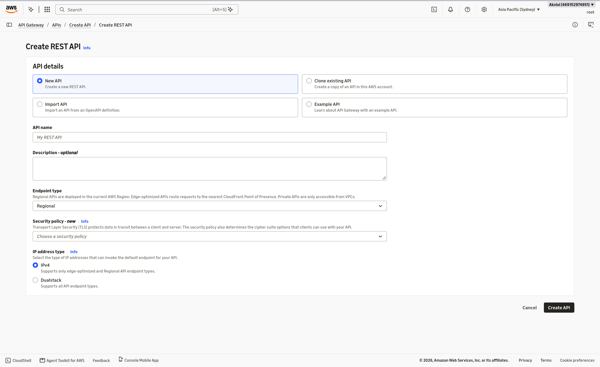
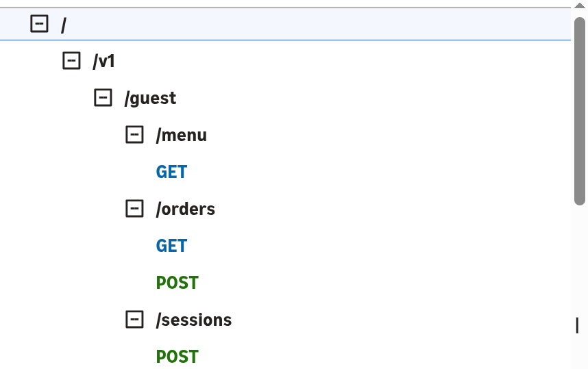
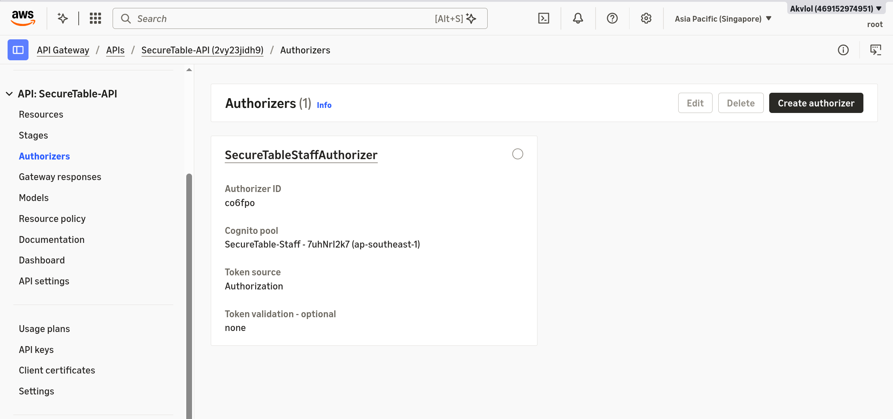
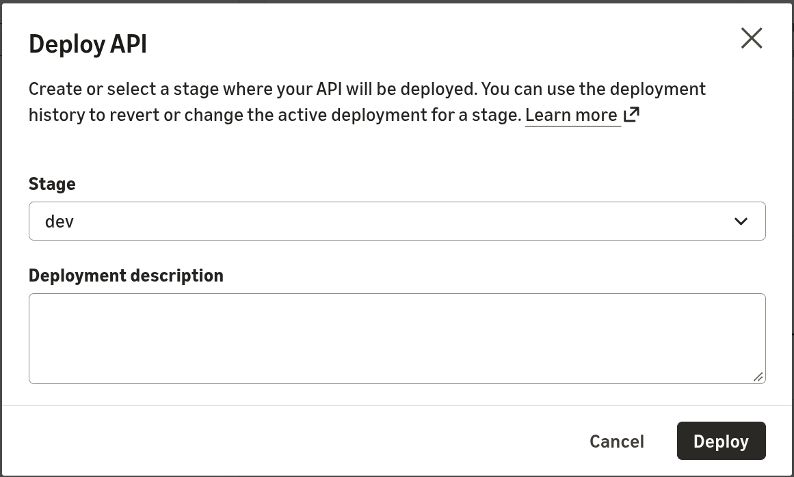
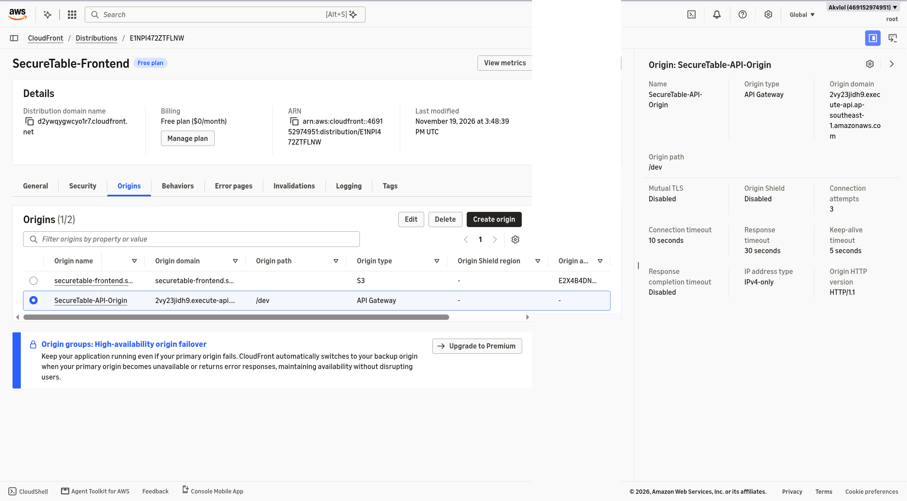
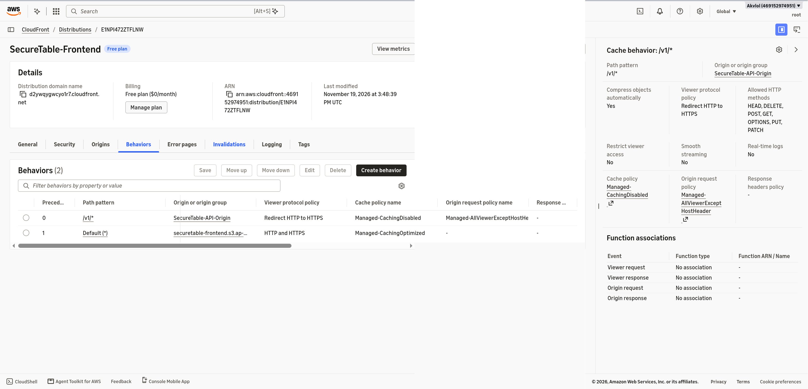

Trong phần này, chúng ta sẽ tạo REST API, cấu hình các **Resources và Methods**, thiết lập **Cognito Authorizer**, kết nối API Gateway với **CloudFront**, sau đó kiểm thử các chức năng chính.

## 1. Tạo REST API trên Amazon API Gateway

1. Truy cập **Amazon API Gateway** trên AWS Console, chọn Region **Asia Pacific (Singapore) – `ap-southeast-1`**.
2. Chọn **APIs → Create API**.
3. Tại loại **REST API**, chọn **Build**.
4. Chọn **New API** và nhập các thông số:

   | Cấu hình | Giá trị |
   |---|---|
   | **API name** | `SecureTable-API` |
   | **API type** | `REST API` |
   | **Endpoint Type** | `Regional` |

5. Chọn **Create API** rồi mở mục **Resources**.



**Lưu ý:** SecureTable sử dụng **REST API**, không phải HTTP API. Toàn bộ Lambda được tạo tại `ap-southeast-1` trong mục trước. Các endpoint sẽ bắt đầu bằng resource `/v1`, còn **deployment stage** sẽ là `dev`.

## 2. Tạo Resources và Methods cho Guest

Chúng ta sẽ tạo `POST /v1/guest/sessions` làm ví dụ:

1. Tại **Resources**, chọn resource gốc `/` → **Create resource**.
2. Tạo resource `v1`, tiếp tục tạo `guest` bên dưới `/v1`, rồi tạo `sessions` bên dưới `/v1/guest`.
3. Chọn resource `/v1/guest/sessions` → **Create method** → chọn HTTP Method **POST**.
4. Tại phần tích hợp, chọn:
   - **Integration type:** `Lambda function`.
   - **Lambda proxy integration:** Bật.
   - **Lambda function:** `SecureTable-GuestServices`.
   - **Region:** `ap-southeast-1`.
5. Tại **Method request / Authorization**, chọn **NONE**.
6. Lưu method và chấp nhận cấp quyền để API Gateway gọi Lambda nếu Console hiển thị yêu cầu xác nhận.

Tiếp tục tạo những endpoint Guest còn lại:

| Method | Resource | Lambda integration | Authorization |
|---|---|---|---|
| `POST` | `/v1/guest/sessions` | `SecureTable-GuestServices` | `NONE` |
| `GET` | `/v1/guest/menu` | `SecureTable-GuestServices` | `NONE` |
| `POST` | `/v1/guest/orders` | `SecureTable-Ordering` | `NONE` |
| `GET` | `/v1/guest/orders` | `SecureTable-Ordering` | `NONE` |



**Lưu ý:** `Authorization: NONE` chỉ có nghĩa là **API Gateway không sử dụng Cognito Authorizer** cho các method này. `POST /guest/sessions` vẫn yêu cầu bàn đang có bill mở; các Guest API còn lại yêu cầu `Authorization: Bearer <guest_session_token>` và được Lambda xác minh. Đặc biệt, `GET /guest/orders` chỉ trả các món thuộc bill đang mở được liên kết với Guest Session, không lấy `bill_id` do khách tự khai báo.

## 3. Tạo Cognito User Pool Authorizer cho Staff

1. Trong `SecureTable-API`, mở **Authorizers → Create authorizer**.
2. Nhập **Authorizer name:** `SecureTableStaffAuthorizer`.
3. Chọn **Authorizer type:** `Cognito` / `Cognito user pool` (tùy giao diện Console).
4. Chọn **Cognito User Pool** đã tạo cho Staff tại `ap-southeast-1`.
5. Tại **Token source**, nhập `Authorization`.
6. Chọn **Create authorizer**.



Khi tạo Method cho Staff, tại **Method request → Authorization**, chọn `SecureTableStaffAuthorizer` và **để trống Authorization Scopes**.

**Lưu ý:** Frontend SecureTable gửi **Cognito ID Token** khi gọi Staff API. Với Cognito User Pool Authorizer của REST API, việc để trống **Authorization Scopes** cho phép API Gateway xác minh ID Token. Sau đó Lambda kiểm tra thêm `cognito:groups` để xác định quyền của `RECEPTION`, `KITCHEN`, `INVENTORY` hoặc `ADMIN`. Đăng nhập thành công không đồng nghĩa với có quyền gọi mọi endpoint.

## 4. Tích hợp các Staff API với Lambda

1. Quay lại **Resources** và tạo resource `staff` bên dưới `/v1`.
2. Tạo các resource con tương ứng với từng nghiệp vụ, ví dụ `bills`, `kitchen`, `inventory`, `finance`.
3. Tạo HTTP Method tại từng resource và chọn **Lambda proxy integration**.
4. Chọn Lambda theo bảng dưới đây.
5. Với **tất cả Staff Methods**, đặt **Authorization:** `SecureTableStaffAuthorizer` và **Authorization Scopes:** để trống.

| Method | Resource | Lambda integration |
|---|---|---|
| `GET` | `/v1/staff/tables` | `SecureTable-Reception` |
| `GET`, `POST` | `/v1/staff/bills` | `SecureTable-Reception` |
| `GET` | `/v1/staff/bills/{billId}` | `SecureTable-Reception` |
| `GET` | `/v1/staff/bills/{billId}/receipt` | `SecureTable-Reception` |
| `POST` | `/v1/staff/bills/{billId}/close` | `SecureTable-Reception` |
| `GET` | `/v1/staff/kitchen/queue` | `SecureTable-Kitchen` |
| `POST` | `/v1/staff/kitchen/items/{itemId}/complete` | `SecureTable-Kitchen` |
| `POST` | `/v1/staff/kitchen/items/{itemId}/reject` | `SecureTable-Kitchen` |
| `GET`, `POST` | `/v1/staff/inventory/receipts` | `SecureTable-Inventory` |
| `GET`, `POST` | `/v1/staff/inventory/receipts/{receiptId}/corrections` | `SecureTable-Inventory` |
| `GET` | `/v1/staff/finance/daily/{date}` | `SecureTable-AdminDashboard` |
| `GET` | `/v1/staff/finance/summary` | `SecureTable-AdminDashboard` |
| `GET` | `/v1/staff/finance/weekly` | `SecureTable-AdminDashboard` |
| `GET` | `/v1/staff/audit-logs` | `SecureTable-AdminDashboard` |

**Lưu ý:**

- Khi tạo `{billId}`, `{itemId}`, `{receiptId}` và `{date}`, hãy giữ nguyên dấu ngoặc nhọn và chữ hoa/thường. Đây là **Path Parameters** được truyền vào Lambda qua `pathParameters`.
- Với resource có nhiều Method như `/v1/staff/bills`, phải tạo **GET** và **POST** riêng, dù cả hai cùng trỏ đến một Lambda.
- Bảng trên gồm các endpoint chính trong bản thiết kế SecureTable. Nếu phiên bản `Inventory` đang triển khai có thêm endpoint đọc nguyên liệu, chi tiết phiếu nhập hoặc kiểm kê, tạo thêm Method/Resource đúng với mã nguồn và lời gọi trong frontend đó; không tự tạo route không tồn tại trong Lambda.

## 5. Deploy REST API vào Stage `dev`

Sau khi tạo xong Resources, Methods và Authorizer:

1. Trong trang `SecureTable-API`, chọn **Deploy API**.
2. Tại **Stage**, chọn **New stage** nếu đây là lần triển khai đầu tiên.
3. Nhập **Stage name:** `dev`, sau đó xác nhận **Deploy**.
4. Mở phần **Stages → dev** và sao chép **Invoke URL**.

Invoke URL có dạng:

```text
https://<api-id>.execute-api.ap-southeast-1.amazonaws.com/dev
```

Ví dụ URL đầy đủ để gọi Guest Session:

```text
https://<api-id>.execute-api.ap-southeast-1.amazonaws.com/dev/v1/guest/sessions
```



**Lưu ý:** `dev` là **Stage**, còn `v1` là **Resource**. Mỗi lần tạo/sửa Method, Integration hoặc Authorization trong REST API, cần **Deploy API lại vào stage `dev`** để thay đổi có hiệu lực. Nếu chưa deploy, người dùng có thể vẫn gọi phiên bản API cũ.

## 6. Kết nối API Gateway với Amazon CloudFront

Trong mã nguồn, frontend gọi API bằng đường dẫn tương đối như `fetch('/v1/guest/menu')`, nên cần thiết lập CloudFront chuyển các request `/v1/*` đến API Gateway.

### 6.1. Thêm API Gateway Origin

1. Mở **CloudFront → Distributions** và chọn distribution đang phục vụ website SecureTable.
2. Chọn **Origins → Create origin**.
3. Cấu hình:

   | Cấu hình | Giá trị |
   |---|---|
   | **Origin domain** | `<api-id>.execute-api.ap-southeast-1.amazonaws.com` |
   | **Origin path** | `/dev` |
   | **Protocol** | `HTTPS only` |

4. Lưu Origin vừa tạo.



### 6.2. Tạo CloudFront Behavior cho API

1. Trong cùng distribution, mở **Behaviors → Create behavior**.
2. Thiết lập:

   | Cấu hình | Giá trị |
   |---|---|
   | **Path pattern** | `/v1/*` |
   | **Origin** | API Gateway Origin vừa tạo |
   | **Viewer protocol policy** | `Redirect HTTP to HTTPS` |
   | **Allowed HTTP methods** | `GET, HEAD, OPTIONS, PUT, POST, PATCH, DELETE` |
   | **Cache policy** | `CachingDisabled` |
   | **Origin request policy** | `AllViewerExceptHostHeader` |

3. Lưu Behavior và xác nhận behavior `/v1/*` có độ ưu tiên phù hợp trước `Default (*)`.
4. Kiểm tra **Default behavior (`*`)** vẫn dùng S3 Origin thông qua OAC để phục vụ HTML, CSS và JavaScript.



Khi frontend yêu cầu:

```text
https://<cloudfront-domain>/v1/guest/menu
```

CloudFront sẽ gọi API Gateway tại:

```text
https://<api-id>.execute-api.ap-southeast-1.amazonaws.com/dev/v1/guest/menu
```

**Lưu ý quan trọng:**

- **Origin path chỉ là `/dev`**, không đặt `/dev/v1`. Vì trình duyệt đã gọi `/v1/...`, việc thêm `v1` vào Origin path sẽ làm lặp đường dẫn và dễ gây lỗi `403`/`404`.
- **Không nhập `https://`** vào trường Origin domain.
- `CachingDisabled` ngăn CloudFront lưu cache phản hồi API động. `AllViewerExceptHostHeader` chuyển tiếp những header cần thiết, bao gồm `Authorization`, đồng thời sử dụng Host của API Gateway Origin. Đây là cấu hình phù hợp với API Gateway sử dụng Bearer Token.
- Vì frontend và API có chung CloudFront domain, các request `fetch('/v1/...')` thông thường **không cần cấu hình CORS riêng**. Nếu sau này frontend gọi trực tiếp domain `execute-api`, cần cấu hình CORS phù hợp.

Sau khi hoàn thành, **frontend SecureTable đã được kết nối với AWS Lambda thông qua CloudFront và API Gateway**, đồng thời các API Staff được xác thực bằng Cognito. Ở phần tiếp theo, [**5.7 – Tự động hóa Báo cáo & Sao lưu dữ liệu**](../../5.7-Automation), chúng ta sẽ cấu hình EventBridge Scheduler, Amazon SNS và cơ chế xuất backup từ DynamoDB sang Amazon S3.