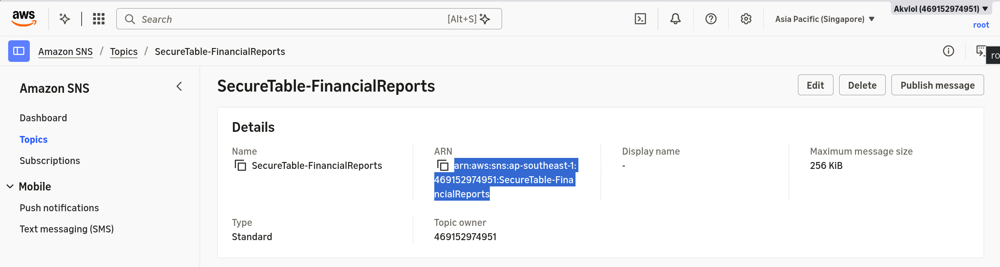
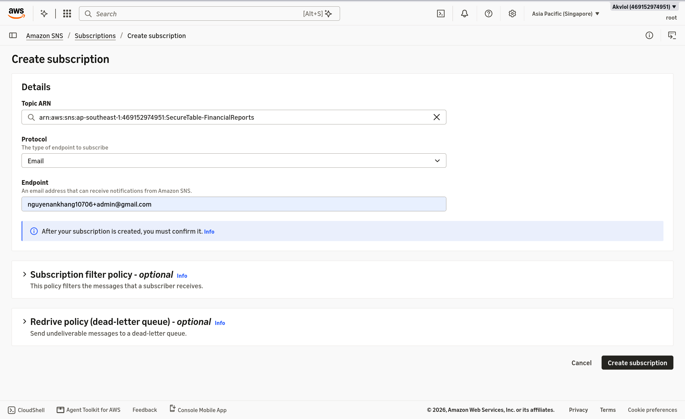
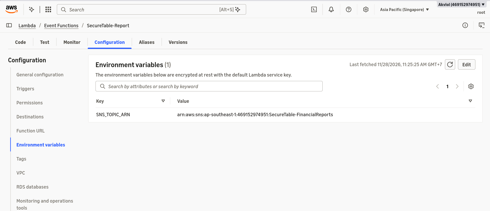
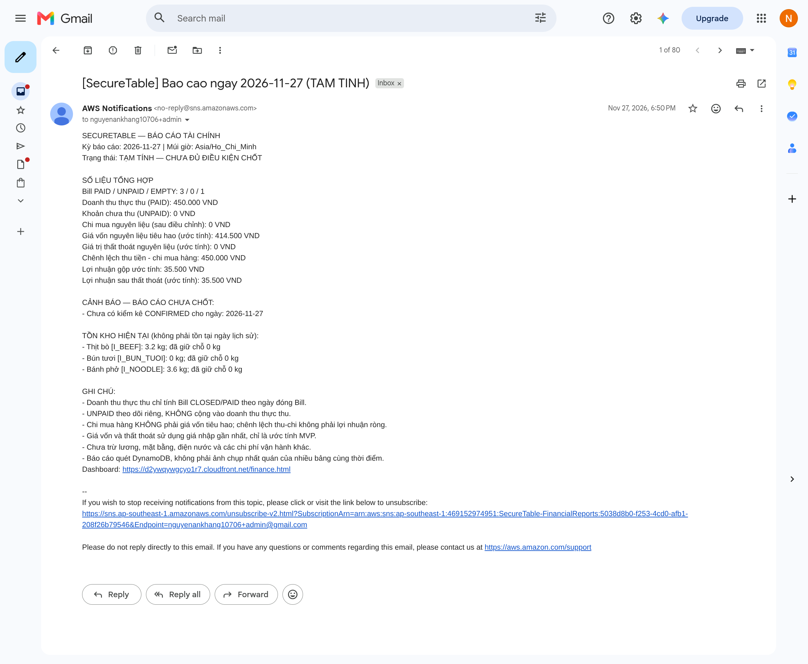
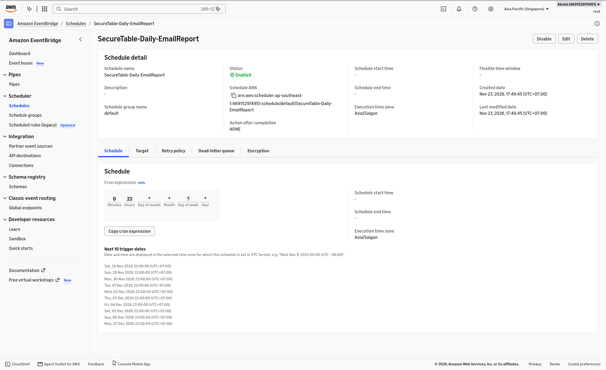
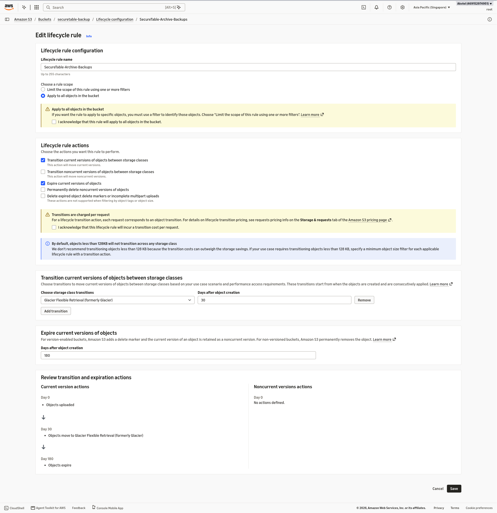
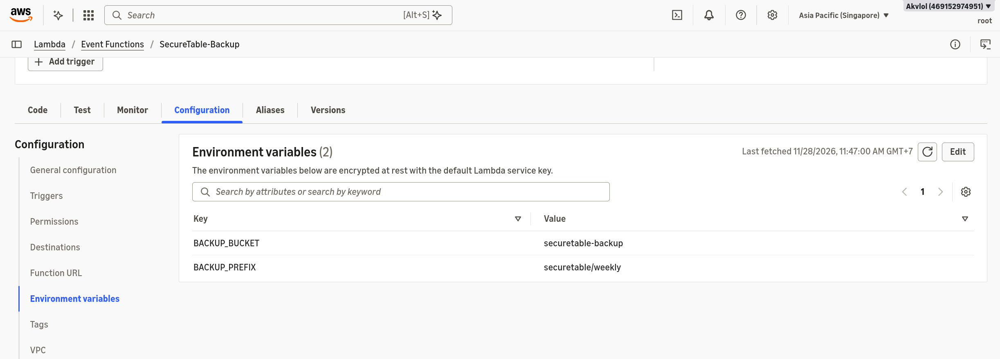
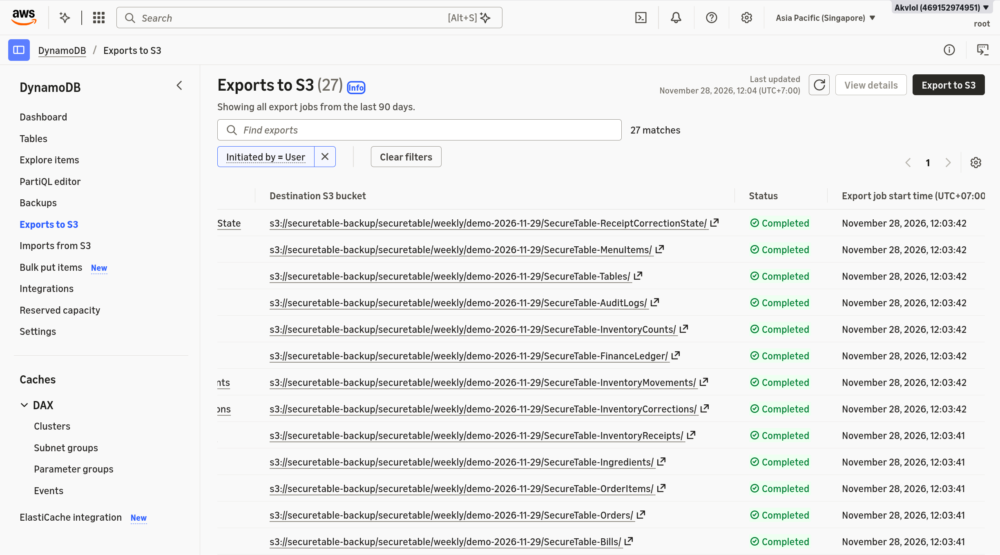
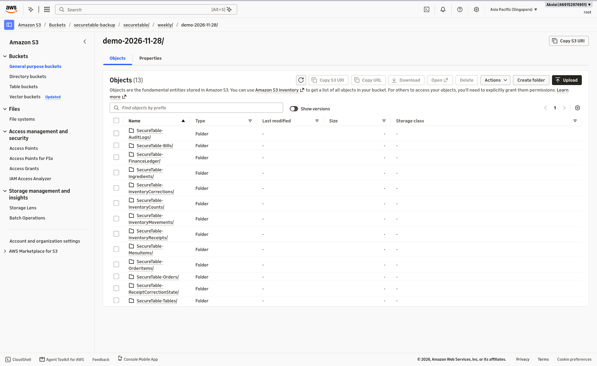
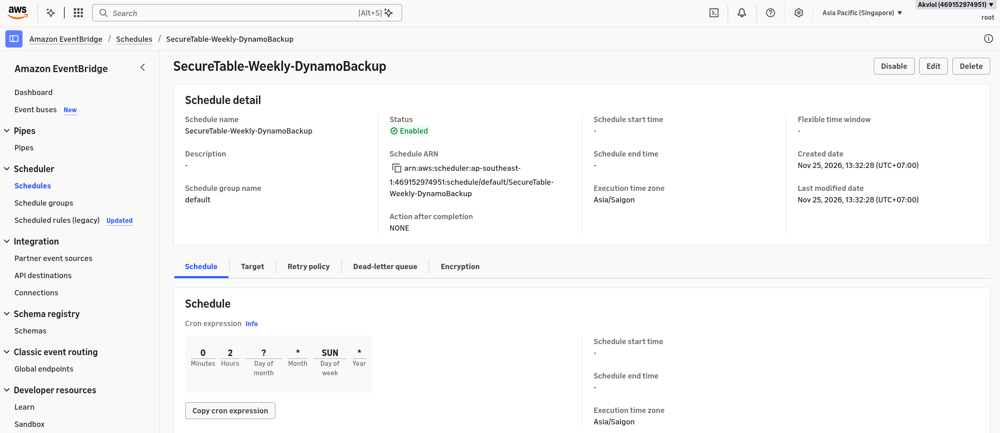

Trong phần này, chúng ta sẽ sử dụng **Amazon EventBridge Scheduler** để tự động gửi báo cáo tài chính và sao lưu dữ liệu của **SecureTable**.

SecureTable sử dụng hai luồng tự động:

- **Báo cáo:** EventBridge Scheduler → `SecureTable-Report` → DynamoDB → Amazon SNS → Email của Admin.
- **Sao lưu:** EventBridge Scheduler → `SecureTable-Backup` → DynamoDB Export to S3 → Amazon S3 → S3 Glacier Flexible Retrieval.

Tất cả tài nguyên được cấu hình tại **Asia Pacific (Singapore) – `ap-southeast-1`**. Các lịch chạy sử dụng múi giờ **`Asia/Ho_Chi_Minh`**.

## 1. Tạo Amazon SNS Topic để gửi báo cáo

Chúng ta sử dụng Amazon SNS để gửi báo cáo từ Lambda đến địa chỉ email của người quản trị.

1. Truy cập **Amazon SNS → Topics → Create topic**.
2. Chọn **Type: Standard**.
3. Nhập **Name:** `SecureTable-FinancialReports`.
4. Giữ các thiết lập phù hợp với môi trường demo, sau đó chọn **Create topic**.
5. Sao chép **Topic ARN**. ARN có dạng:

   ```text
   arn:aws:sns:ap-southeast-1:<YOUR_ACCOUNT_ID>:SecureTable-FinancialReports
   ```



6. Mở topic vừa tạo → **Create subscription**.
7. Chọn **Protocol: Email**, nhập email nhận báo cáo tại **Endpoint**, rồi chọn **Create subscription**.
8. Kiểm tra hộp thư đến, mở email xác nhận từ AWS và chọn **Confirm subscription**.
9. Quay lại SNS, xác nhận subscription chuyển sang trạng thái **Confirmed**.



**Lưu ý:** Nếu subscription vẫn ở trạng thái `Pending confirmation`, SNS sẽ chưa gửi báo cáo đến email đó. Có thể dùng **Publish message** trong SNS Topic để kiểm tra việc nhận email trước khi kết nối Lambda.

## 2. Cấu hình và kiểm thử Report Lambda

Lambda `SecureTable-Report` đọc dữ liệu từ các bảng nghiệp vụ DynamoDB, tổng hợp báo cáo và gửi nội dung qua SNS. Bảng `SecureTable-ReportDispatch` được dùng để theo dõi trạng thái phát hành, hạn chế gửi trùng báo cáo.

### 2.1. Cấu hình Report Lambda

1. Truy cập **AWS Lambda → Functions → SecureTable-Report**.
2. Chọn **Configuration → Environment variables → Edit**.
3. Thêm biến môi trường:

   | Key | Value |
   |---|---|
   | `SNS_TOPIC_ARN` | ARN của topic `SecureTable-FinancialReports` đã tạo ở bước 1 |

4. Chọn **Save**.



### 2.2. Kiểm thử gửi báo cáo

1. Trong Lambda `SecureTable-Report`, mở tab **Test → Create new event**.
2. Tạo event kiểm thử dạng `dry_run`:

   ```json
   {
     "report_type": "DAILY",
     "business_date": "2026-11-27",
     "dry_run": true
   }
   ```

3. Chọn **Test**, xem phản hồi và **CloudWatch Logs** để kiểm tra dữ liệu tổng hợp. Đổi `business_date` thành một ngày thực tế có dữ liệu trong hệ thống.
4. Sau khi xác nhận kết quả hợp lệ và subscription email đã được xác nhận, có thể thử gửi báo cáo thật bằng cách đổi `"dry_run": false`.
5. Kiểm tra email nhận được và bản ghi tương ứng trong `SecureTable-ReportDispatch`.



**Lưu ý:** `dry_run: true` chỉ kiểm tra việc tổng hợp, không được hiểu là báo cáo đã gửi thành công. Khi chạy thật, kiểm tra phản hồi SNS và trạng thái trong `SecureTable-ReportDispatch`. Tránh thử gửi lặp cùng kỳ báo cáo nhiều lần; cơ chế deduplication được thiết kế để hạn chế điều đó.

## 3. Tạo EventBridge Scheduler cho báo cáo ngày và tuần

Chúng ta tạo **hai lịch** cùng gọi `SecureTable-Report`: một lịch hằng ngày và một lịch hằng tuần.

1. Truy cập **Amazon EventBridge → Scheduler → Create schedule**.
2. Đặt tên lịch **`SecureTable-Daily-EmailReport`**.
3. Chọn **Recurring schedule** và thiết lập:

   | Cấu hình | Giá trị |
   |---|---|
   | **Schedule type** | Cron-based schedule |
   | **Cron expression** | `cron(0 22 * * ? *)` |
   | **Time zone** | `Asia/Ho_Chi_Minh` |
   | **Flexible time window** | Off |
   | **Schedule state** | Enabled |

4. Ở phần **Target**, chọn **AWS Lambda → Invoke**, sau đó chọn `SecureTable-Report`.
5. Cấu hình **Input / Payload**:

   ```json
   {
     "report_type": "DAILY",
     "scheduled_at": "<aws.scheduler.scheduled-time>"
   }
   ```

6. Tại phần **Execution role**, chọn **Create new role for this schedule** để EventBridge Scheduler có quyền `lambda:InvokeFunction` đối với `SecureTable-Report`.
7. Hoàn tất **Create schedule**.



8. Tạo lịch thứ hai với cấu hình:

   | Cấu hình | Giá trị |
   |---|---|
   | **Name** | `SecureTable-Weekly-EmailReport` |
   | **Cron expression** | `cron(15 22 ? * SUN *)` |
   | **Time zone** | `Asia/Ho_Chi_Minh` |
   | **Flexible time window** | Off |
   | **Target** | `SecureTable-Report` |

9. Nhập payload cho báo cáo tuần:

   ```json
   {
     "report_type": "WEEKLY",
     "scheduled_at": "<aws.scheduler.scheduled-time>"
   }
   ```

10. Tạo Execution Role dành cho lịch này khi Console yêu cầu, sau đó hoàn tất.

**Lưu ý:** Chuỗi `<aws.scheduler.scheduled-time>` là **context attribute** được EventBridge Scheduler thay bằng thời điểm chạy lịch. Múi giờ lịch được đặt là Việt Nam, còn thời điểm được truyền trong payload có thể ở định dạng UTC; Lambda cần quy đổi theo ngày báo cáo. **Scheduler Execution Role khác với Lambda Execution Role**: Scheduler cần quyền gọi Lambda, còn Lambda cần quyền đọc DynamoDB và gửi SNS.

## 4. Bật Point-in-Time Recovery (PITR) cho DynamoDB

Để xuất dữ liệu DynamoDB sang S3, chúng ta cần bật **Point-in-Time Recovery (PITR)** trên các bảng nằm trong phạm vi sao lưu.

1. Mở **Amazon DynamoDB → Tables**.
2. Chọn một bảng, ví dụ `SecureTable-Bills`.
3. Mở **Backups → Point-in-time recovery (PITR)** và chọn **Turn on**.
4. Lưu cấu hình và kiểm tra trạng thái chuyển thành **Enabled**.
5. Thực hiện tương tự với **13 bảng** sau:

| STT | DynamoDB Table |
|---:|---|
| 1 | `SecureTable-Bills` |
| 2 | `SecureTable-Orders` |
| 3 | `SecureTable-OrderItems` |
| 4 | `SecureTable-Ingredients` |
| 5 | `SecureTable-InventoryReceipts` |
| 6 | `SecureTable-InventoryCorrections` |
| 7 | `SecureTable-InventoryMovements` |
| 8 | `SecureTable-FinanceLedger` |
| 9 | `SecureTable-InventoryCounts` |
| 10 | `SecureTable-AuditLogs` |
| 11 | `SecureTable-Tables` |
| 12 | `SecureTable-MenuItems` |
| 13 | `SecureTable-ReceiptCorrectionState` |

**Lưu ý:** Không phải cả **18 bảng** đều được export trong lịch sao lưu này. Các bảng hỗ trợ như `GuestSessions`, `Idempotency`, `PendingByIngredient`, `ReportDispatch` và `NotificationOutbox` không thuộc danh sách 13 bảng. PITR được tính phí riêng trong thời gian bật, **ngay cả khi chưa chạy export**. Sau khi mới bật PITR, có thể cần đợi để cửa sổ thời gian phục hồi bao phủ thời điểm mà Backup Lambda yêu cầu.

## 5. Tạo S3 Bucket và thiết lập Lifecycle sang Glacier

Backup Lambda sẽ yêu cầu DynamoDB xuất dữ liệu vào một **S3 bucket riêng**, không sử dụng bucket chứa frontend.

### 5.1. Tạo S3 Bucket để lưu backup

1. Truy cập **Amazon S3 → General purpose buckets → Create bucket**.
2. Chọn Region **Asia Pacific (Singapore) – `ap-southeast-1`**.
3. Đặt tên bucket duy nhất, ví dụ `<YOUR_BACKUP_BUCKET>` (thay bằng tên hợp lệ và chưa được sử dụng).
4. Giữ **Block all public access** ở trạng thái bật.
5. Sử dụng mã hóa mặc định **SSE-S3**, sau đó chọn **Create bucket**.

### 5.2. Tạo S3 Lifecycle Rule

1. Mở bucket vừa tạo → **Management → Create lifecycle rule**.
2. Đặt tên rule, ví dụ `SecureTable-ArchiveToGlacier`.
3. Giới hạn phạm vi bằng **Prefix:** `securetable/weekly/`.
4. Chọn hành động **Transition current versions of objects between storage classes**.
5. Cấu hình:

   | Cấu hình | Giá trị |
   |---|---|
   | **Choose storage class transitions** | `S3 Glacier Flexible Retrieval` |
   | **Transition after** | 30 days |
   | **Expire after** | 180 days |




**Lưu ý:** Mặc định, Lifecycle Rule mới của S3 **không chuyển các object nhỏ hơn 128 KB** sang storage class khác. Một số file manifest do DynamoDB export tạo ra có thể nằm dưới ngưỡng này. **S3 Glacier Flexible Retrieval** cũng có phí chuyển lớp, truy xuất và thời gian tính phí lưu trữ tối thiểu.

## 6. Cấu hình và kiểm thử Backup Lambda

1. Vào **AWS Lambda → Functions → SecureTable-Backup → Configuration → Environment variables → Edit**.
2. Thêm hoặc cập nhật:

   | Key | Value |
   |---|---|
   | `BACKUP_BUCKET` | Tên S3 backup bucket thực tế, không có `s3://` |
   | `BACKUP_PREFIX` | `securetable/weekly` |

3. Mở **Configuration → General configuration** và sử dụng **Memory: 256 MB**, **Timeout: 120 seconds** làm cấu hình khởi đầu.
4. Mở **Configuration → Permissions**, kiểm tra Inline Policy của `SecureTable-Backup` được lấy từ `Lambda/Backup/SecureTable-Backup.json`.
5. Kiểm tra đã thay `<YOUR_ACCOUNT_ID>` và `<YOUR_BACKUP_BUCKET>` trong JSON, cũng như quyền export cho đúng 13 bảng và quyền ghi object dưới `securetable/weekly/*`.



### 6.1. Chạy thử mà không tạo bản export

1. Mở **Test → Create new event** của Backup Lambda.
2. Nhập payload:

   ```json
   {
     "dry_run": true,
     "backup_id": "demo-2026-11-28"
   }
   ```

3. Chọn **Test**.
4. Kiểm tra kết quả có `ready: true`, `table_count: 13`. Nếu `ready: false`, xem danh sách bảng thiếu hoặc bảng chưa bật PITR.

### 6.2. Chạy thử export thật

Sau khi cả 13 bảng đều sẵn sàng, có thể kiểm thử export thật bằng payload:

```json
{
  "dry_run": false,
  "backup_id": "demo-2026-11-28"
}
```

Backup Lambda sẽ yêu cầu **DynamoDB Export to S3** cho từng bảng. Phản hồi khởi tạo dự kiến gồm `mode: STARTED`, `exports_requested: 13` và các `export_arn`.

1. Vào **DynamoDB → Exports to S3** để kiểm tra trạng thái các tác vụ.
2. Đợi từng export chuyển sang **COMPLETED**; nếu xuất hiện **FAILED**, xem chi tiết lỗi và CloudWatch Logs.
3. Vào **S3 → backup bucket**, tìm dữ liệu trong prefix tương ứng:

   ```text
   securetable/weekly/demo-2026-11-28/<table-name>/AWSDynamoDB/...
   ```

4. Mở các thư mục export để kiểm tra các file manifest và dữ liệu đã xuất.




## 7. Tạo EventBridge Scheduler cho Backup hàng tuần

1. Truy cập **Amazon EventBridge → Scheduler → Create schedule**.
2. Nhập **Name:** `SecureTable-Weekly-DynamoBackup`.
3. Chọn **Recurring schedule** và cấu hình:

   | Cấu hình | Giá trị |
   |---|---|
   | **Cron expression** | `cron(0 2 ? * SUN *)` |
   | **Time zone** | `Asia/Ho_Chi_Minh` |
   | **Flexible time window** | Off |
   | **Target** | AWS Lambda → `SecureTable-Backup` |
   | **Schedule state** | Enabled |

4. Tại **Input / Payload**, nhập:

   ```json
   {
     "scheduled_at": "<aws.scheduler.scheduled-time>"
   }
   ```

5. Tại **Execution role**, chọn **Create new role for this schedule**, cho phép EventBridge Scheduler gọi riêng Lambda `SecureTable-Backup`.
6. Kiểm tra cấu hình và chọn **Create schedule**.



Theo lịch này, Backup Lambda chạy lúc **02:00 Chủ nhật (giờ Việt Nam)**. Lambda lựa chọn một thời điểm trong cửa sổ PITR trước khi khởi tạo các export. Các tác vụ DynamoDB Export tiếp tục chạy sau khi Lambda kết thúc.

Sau khi hoàn thành, **SecureTable đã tự động gửi báo cáo qua SNS và sao lưu định kỳ 13 bảng DynamoDB sang Amazon S3**. Ở phần tiếp theo, **5.8 – Tăng cường Bảo mật & Giám sát hệ thống**, chúng ta sẽ kiểm tra CloudWatch, cảnh báo lỗi và các cấu hình bảo mật bổ sung.
