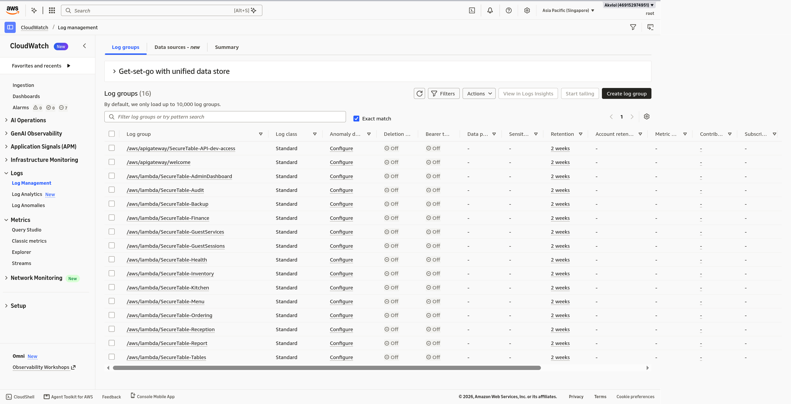
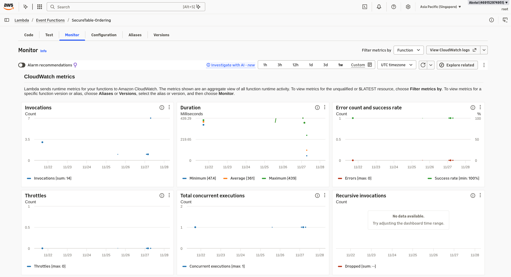
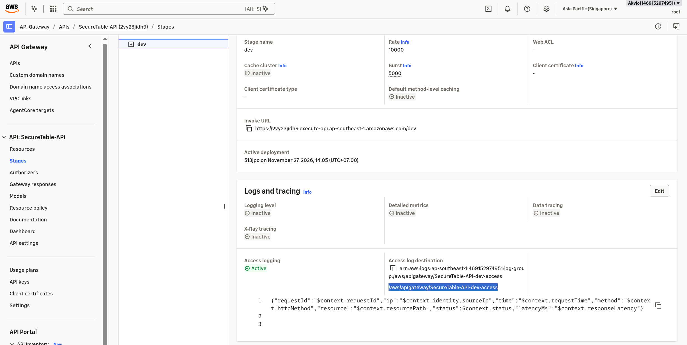
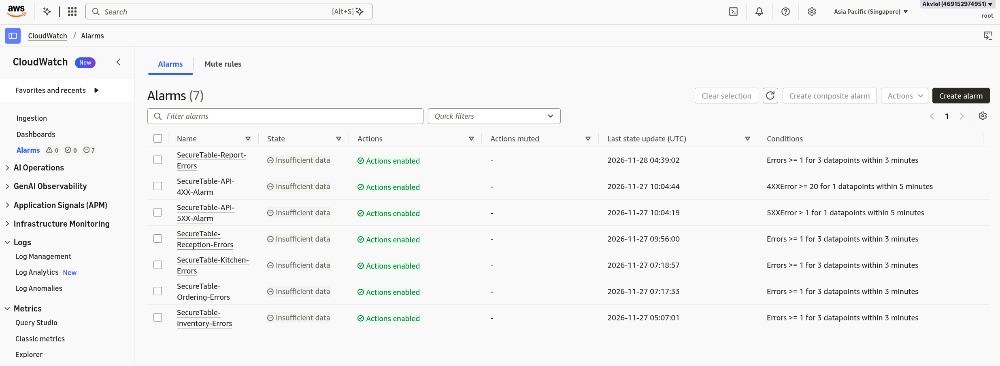
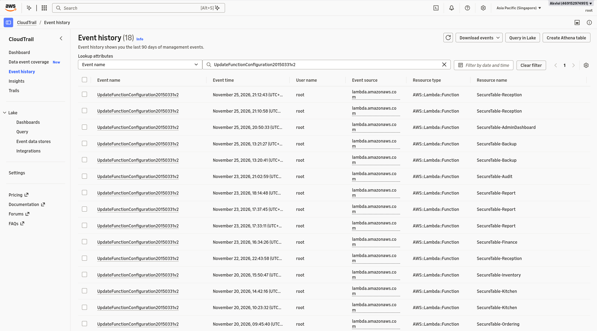
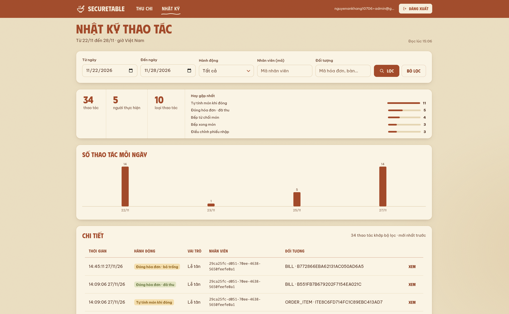

SecureTable sử dụng **CloudFront + S3**, **Cognito + IAM**, **API Gateway + Lambda** và **DynamoDB**. Chúng ta sẽ sử dụng **AWS WAF**, **Amazon CloudWatch**, **Amazon SNS** và **AWS CloudTrail** để bổ sung khả năng quan sát và phát hiện vấn đề.

## 1. Kiểm tra bảo mật của Frontend và API

### 1.1. Kiểm tra S3 và CloudFront

1. Vào **Amazon S3 → Buckets**, mở bucket lưu frontend SecureTable.
2. Trong **Permissions**, xác nhận **Block all public access** đang bật.
3. Kiểm tra **Bucket policy** chỉ cấp quyền đọc cần thiết cho CloudFront thông qua **Origin Access Control (OAC)**; không mở quyền đọc công khai bằng `Principal: "*"`.
4. Mở **CloudFront → Distributions → chọn distribution SecureTable → Origins**.
5. Xác nhận S3 Origin sử dụng OAC và API Gateway Origin trỏ đến domain `execute-api` của REST API.
6. Tại **Behaviors**, kiểm tra:

   | Behavior | Origin | Thiết lập cần kiểm tra |
   |---|---|---|
   | `Default (*)` | S3 Frontend | `Redirect HTTP to HTTPS`, OAC ở S3 Origin |
   | `/v1/*` | API Gateway | `Redirect HTTP to HTTPS`, `CachingDisabled`, `AllViewerExceptHostHeader` |

**Lưu ý:** API chứa Guest Session, đơn hàng và dữ liệu nhân viên **không được cache ở CloudFront**. CloudFront phân phối frontend qua HTTPS, nhưng không thay thế việc xác thực và kiểm tra quyền trong Backend.

### 1.2. Kiểm tra xác thực và phân quyền

1. Vào **Amazon Cognito → User pools → SecureTable-Staff**.
2. Kiểm tra **Self-registration** đã tắt nếu tài khoản nhân viên chỉ được quản trị viên tạo.
3. Xác nhận các Cognito Groups sử dụng trong ứng dụng: `RECEPTION`, `KITCHEN`, `INVENTORY`, `ADMIN`.
4. Vào **API Gateway → SecureTable-API → Resources**, kiểm tra các Staff Methods sử dụng `SecureTableStaffAuthorizer`.
5. Đối với Staff API đang dùng **Cognito ID Token**, giữ **Authorization Scopes** để trống
6. Kiểm tra Lambda tiếp tục xác minh nhóm `cognito:groups` trước khi xử lý từng nghiệp vụ.

## 2. Rà soát IAM theo nguyên tắc Least Privilege

Mỗi Lambda SecureTable có một **Execution Role riêng** và một **Inline Policy** theo chức năng.

1. Truy cập **AWS Lambda → Functions**, mở một function, ví dụ `SecureTable-Ordering`.
2. Chọn **Configuration → Permissions** và nhấn vào tên **Execution Role** để mở IAM.
3. Xác nhận role có `AWSLambdaBasicExecutionRole` để ghi CloudWatch Logs và Inline Policy đúng chức năng.
4. Đối chiếu các quyền DynamoDB với tên bảng mà Lambda cần sử dụng.
5. Lặp lại cho các Lambda quan trọng như `SecureTable-Kitchen`, `SecureTable-Report` và `SecureTable-Backup`.

| Lambda | Quyền cần tập trung kiểm tra |
|---|---|
| `SecureTable-Ordering` | Đọc menu, bill, session; ghi đơn hàng và giữ nguyên liệu |
| `SecureTable-Kitchen` | Đọc hàng đợi; cập nhật trạng thái món, tồn kho và bill |
| `SecureTable-AdminDashboard` | Đọc dữ liệu Finance và Audit Logs |
| `SecureTable-Report` | Đọc các bảng báo cáo, cập nhật `ReportDispatch`, `sns:Publish` |
| `SecureTable-Backup` | Export 13 bảng DynamoDB và ghi object vào bucket backup |

**Kiểm tra đặc biệt với Backup Lambda:** Đường dẫn S3 trong IAM phải khớp với **bucket thực tế** và giá trị `BACKUP_PREFIX` đã cấu hình ở mục 5.7. Ví dụ, nếu bucket là `securetable-backup` và prefix là `securetable/weekly`, quyền ghi object phải bao phủ:

```text
arn:aws:s3:::securetable-backup/securetable/weekly/*
```

Trong Inline Policy tương ứng, quyền cần thiết có thể bao gồm `s3:PutObject`, `s3:PutObjectAcl` và `s3:AbortMultipartUpload`. Nếu thiếu `s3:PutObject`, Lambda có thể **khởi tạo yêu cầu export thành công** nhưng các DynamoDB Export jobs vẫn chuyển sang `FAILED` do `AccessDenied`.

## 3. Kiểm tra AWS WAF trên CloudFront

1. Mở **CloudFront → Distributions → chọn distribution SecureTable**.
2. Kiểm tra mục **Security / AWS WAF** để xác định Web ACL (protection pack) đang được liên kết.
3. Mở liên kết đến **AWS WAF** và chọn phạm vi **CloudFront distributions (Global)**.
4. Mở Web ACL tương ứng, kiểm tra **Traffic overview**, các rule đang hoạt động và số lượng request được **Allowed**, **Blocked** hoặc **Counted**.
5. Nếu thêm AWS Managed Rules hoặc Rate-based Rule, nên **quan sát bằng Count trước** rồi mới cân nhắc chuyển sang Block, tránh chặn nhầm thao tác đặt món hoặc đăng nhập hợp lệ.

**Lưu ý:** Đối với Web ACL bảo vệ CloudFront, AWS WAF sử dụng phạm vi **Global / CloudFront** (API quản lý tài nguyên này dùng `us-east-1`), dù các Lambda và DynamoDB của SecureTable nằm ở Singapore. Kiểm tra giới hạn tính năng và chi phí theo **CloudFront Plan** hiện tại trước khi bật thêm rule tính phí riêng.

**Giới hạn bảo vệ:** WAF gắn với CloudFront chỉ kiểm tra request **đi qua CloudFront**. Nếu endpoint mặc định `execute-api` của API Gateway còn truy cập trực tiếp được, request đi trực tiếp vào endpoint đó không qua Web ACL của CloudFront. Do đó vẫn phải giữ **Cognito Authorizer**, xác minh Guest Token và kiểm tra role ở Lambda.

## 4. Giám sát AWS Lambda bằng CloudWatch

### 4.1. Kiểm tra Log Groups

AWS Lambda ghi log vào CloudWatch khi Execution Role có quyền phù hợp. Chúng ta sẽ kiểm tra log của 8 Lambda:

1. Mở **Amazon CloudWatch → Logs → Log Management** tại Region `ap-southeast-1`.
2. Tìm các log group có tên `/aws/lambda/SecureTable-...`.
3. Mở `/aws/lambda/SecureTable-Ordering` hoặc `/aws/lambda/SecureTable-Kitchen`.
4. Chọn một **Log stream** gần nhất để kiểm tra thời gian chạy, lỗi và thông tin xử lý request.
5. Với từng log group, chọn **Actions → Edit retention setting**, đặt thời gian lưu ví dụ **14 days** cho môi trường demo, rồi lưu lại.



### 4.2. Kiểm tra Metrics

1. Trong AWS Lambda, mở `SecureTable-Ordering` → **Monitor → Metrics**.
2. Quan sát các metrics: **Invocations**, **Errors**, **Duration** và **Throttles**.
3. Lặp lại với `SecureTable-Kitchen`, `SecureTable-Inventory`, `SecureTable-Report` và `SecureTable-Backup`.

| Metric | Ý nghĩa |
|---|---|
| `Invocations` | Số lần Lambda được gọi |
| `Errors` | Số lần thực thi có lỗi ở cấp Lambda/runtime |
| `Duration` | Thời gian xử lý function |
| `Throttles` | Số yêu cầu bị từ chối do giới hạn đồng thời |



**Lưu ý:** Nếu Lambda tự xử lý lỗi và trả về JSON với HTTP `400` hoặc `500` mà không phát sinh lỗi thực thi, metric **Lambda `Errors` có thể không tăng**. Vì thế cần kết hợp với số liệu lỗi của API Gateway và log ứng dụng, không chỉ dựa vào một metric.

## 5. Bật Access Logging cho API Gateway REST API

Access Logs giúp theo dõi request tới `SecureTable-API`, kể cả khi request bị từ chối ở lớp API Gateway.

### 5.1. Chuẩn bị quyền ghi CloudWatch Logs

1. Mở **IAM → Roles** và kiểm tra đã có role dành cho API Gateway ghi CloudWatch Logs hay chưa.
2. Nếu chưa có, tạo IAM Role có **Trusted entity: API Gateway** (`apigateway.amazonaws.com`) và gắn AWS Managed Policy **`AmazonAPIGatewayPushToCloudWatchLogs`**.
3. Sao chép ARN của role.
4. Mở **API Gateway → Settings / Account settings** tại Region Singapore và đặt **CloudWatch log role ARN** bằng ARN của role vừa kiểm tra hoặc tạo.

**Lưu ý:** Đây là **role cho API Gateway ghi log**, khác với các Lambda Execution Roles và các EventBridge Scheduler Execution Roles. Không dùng nhầm role Lambda cho bước này.

### 5.2. Cấu hình Access Logging tại Stage `dev`

1. Mở **API Gateway → APIs → SecureTable-API → Stages → dev**.
2. Chọn mục **Logs and tracing / Logging** rồi bật **Access logging**.
3. Tạo hoặc chọn một CloudWatch Log Group, ví dụ `/aws/apigateway/SecureTable-API-dev-access`.
4. Nhập định dạng JSON cho Access Logs:

   ```json
   {
     "requestId": "$context.requestId",
     "requestTime": "$context.requestTime",
     "httpMethod": "$context.httpMethod",
     "resourcePath": "$context.resourcePath",
     "status": "$context.status",
     "responseLatency": "$context.responseLatency"
   }
   ```

5. Lưu cấu hình. Trong CloudWatch, đặt **Log retention: 14 days** cho log group này nếu phù hợp.
6. Truy cập một API hợp lệ qua CloudFront rồi mở log group để xác nhận request mới đã được ghi.



**Lưu ý:** Chỉ log các trường cần thiết để giám sát. **Không đưa header `Authorization` hay request body chứa thông tin phiên** vào Access Logs. Nếu bật thêm Execution Logging, không nên bật Data tracing trong môi trường có dữ liệu thật vì có thể ghi nội dung request/response nhạy cảm và làm tăng chi phí.

## 6. Tạo CloudWatch Alarm và thông báo qua SNS

Chúng ta sẽ tạo cảnh báo khi một Lambda có lỗi thực thi. Ví dụ sử dụng `SecureTable-Ordering`; các function khác có thể cấu hình tương tự.

### 6.1. Tạo SNS Topic cho cảnh báo hệ thống

1. Mở **Amazon SNS → Topics → Create topic**.
2. Chọn **Standard** và đặt tên `SecureTable-SystemAlerts`.
3. Sau khi tạo topic, mở **Create subscription** với **Protocol: Email**.
4. Nhập email nhận cảnh báo và **Confirm subscription** trong hộp thư.

### 6.2. Tạo alarm cho Ordering Lambda

1. Vào **CloudWatch → Alarms → All alarms → Create alarm**.
2. Chọn **Select metric → Lambda → By Function Name**.
3. Chọn `SecureTable-Ordering` → metric **Errors**.
4. Cấu hình:

   | Setting | Value tham khảo |
   |---|---|
   | **Statistic** | `Sum` |
   | **Period** | `5 minutes` |
   | **Threshold type** | `Static` |
   | **Condition** | `Errors >= 1` |
   | **Evaluation periods** | `1` |
   | **Missing data treatment** | `Treat missing data as not breaching` |
   | **Alarm action** | Gửi đến `SecureTable-SystemAlerts` |
   | **Alarm name** | `SecureTable-Ordering-Errors` |

5. Chọn **Create alarm** và xác nhận alarm xuất hiện trong danh sách.
6. Có thể tạo thêm alarm tương tự `SecureTable-Kitchen-Errors` cho Kitchen Lambda.

**Lưu ý:** Ngưỡng `Errors >= 1` trong 5 phút có thể gây nhiều cảnh báo khi hệ thống lớn hơn. CloudWatch gửi SNS khi alarm **chuyển trạng thái** phù hợp, không phải cứ mỗi request lỗi là sẽ gửi một email. Kiểm tra cả **Alarm history** và email đã xác nhận để xác minh cơ chế hoạt động.

### 6.3. Theo dõi lỗi API Gateway và tác vụ tự động

- **API Gateway:** Mở **CloudWatch → Metrics → API Gateway** hoặc trang Metrics của `SecureTable-API/dev`, kiểm tra `4XXError`, `5XXError`, `Count` và `Latency`. Có thể tạo alarm cho `5XXError` nếu cần. `4XXError` cũng có thể bao gồm các yêu cầu bị từ chối hợp lệ, không nhất thiết là lỗi hệ thống.
- **Report Lambda:** Kiểm tra CloudWatch Logs, tình trạng SNS Subscription và bản ghi `SecureTable-ReportDispatch` để biết báo cáo đã gửi hay chưa.
- **Backup Lambda:** Sau khi chạy, luôn kiểm tra **DynamoDB → Exports to S3** cho tới khi từng job chuyển sang `COMPLETED`. **Lambda chạy thành công không đồng nghĩa export đã hoàn thành**; lỗi ghi S3 như `AccessDenied` có thể chỉ xuất hiện khi export đang thực hiện.



## 7. Kiểm tra AWS CloudTrail và Audit Logs

**AWS CloudTrail** theo dõi hoạt động quản trị trên AWS, còn **Audit Logs của SecureTable** ghi nhận các thay đổi nghiệp vụ trong ứng dụng. Hai loại dữ liệu này phục vụ những mục đích khác nhau.

1. Truy cập **AWS CloudTrail → Event history** tại Region `ap-southeast-1`.
2. Chọn bộ lọc **Event name** hoặc **Event source**, tìm các thao tác quản trị gần đây liên quan Lambda, IAM, DynamoDB hoặc S3.
3. Mở một sự kiện để xem **Event time**, **Event name**, **User name** và chi tiết liên quan.
4. Trở lại SecureTable, đăng nhập Admin và mở **Audit Dashboard**.
5. Đối chiếu các thao tác nghiệp vụ đã thực hiện như nhập kho, điều chỉnh hoặc xử lý bill (nếu mã nguồn có ghi audit cho các thao tác đó).




**Lưu ý:** CloudTrail **Event history** hiển thị các **management events trong 90 ngày gần nhất** và không thay thế Business Audit Logs. Event history **không hiển thị data events** như mọi lần đọc/ghi item DynamoDB. Muốn lưu lịch sử dài hơn hoặc theo dõi data events cần cấu hình Trail/CloudTrail Lake phù hợp, đồng thời xem xét chi phí.

## 8. Kiểm tra kết quả

Sau khi thực hiện xong, kiểm tra các thành phần sau:

| Thành phần | Kết quả cần xác nhận |
|---|---|
| S3 + CloudFront | Bucket không public; OAC và HTTPS hoạt động; API behavior không cache |
| Cognito + API Gateway | Staff API yêu cầu token hợp lệ; Lambda kiểm tra group |
| IAM | Tám Lambda có quyền tối thiểu theo chức năng; Backup có đúng quyền ghi S3 |
| AWS WAF | Web ACL liên kết đúng CloudFront distribution và có metrics để quan sát |
| CloudWatch Logs | Có log mới cho Lambda và Access Logs của API Gateway |
| CloudWatch Alarm | `SecureTable-Ordering-Errors` được tạo và gắn SNS Topic đã xác nhận |
| CloudTrail | Xem được management events liên quan tài nguyên AWS |
| Backup | Export jobs đạt `COMPLETED`, không chỉ dừng ở phản hồi STARTED từ Lambda |

Sau khi hoàn thành, SecureTable có khả năng **kiểm tra và hạn chế quyền truy cập**, **quan sát log và metrics**, **nhận cảnh báo lỗi thực thi** và **đối chiếu hoạt động quản trị AWS với lịch sử nghiệp vụ**.
